# Rastok architecture

> Implementation blueprint: non-normative and under review.

> **Current implementation** ([format registry](docs/spec/identity.md)). The Node/Graph/Executor/Connector/Extension
> model, explicit dispositions, recursive Dispatch and Loop manager recovery
> are executable. [R9](docs/architecture/rework-r9-qualification.md) records
> the v16 qualification and remaining named limits; the
> [v17 amendment](docs/architecture/loop-host-terminal-v17.md) records Loop
> exhaustion on a resolved host terminal, with no contributed port.
> [Exact-instance closure](docs/architecture/instance-stop-command.md) adds
> bounded, retained lifecycle requests without restoring Graph handlers.
> The [Node realignment](docs/architecture/node-realignment-identity.md) puts
> Graph, Operator and Connector declarations in one table, with wiring in
> each Graph and handlers in each Operator. Private execution indexes are
> derived during validation; journal identities continue to use paths.

This document explains how the current Rastok specification becomes an
executable system. It defines implementation boundaries, dependency direction,
and the current executable foundation. It does not add
language or runtime semantics.

## Authority and change discipline

Repository knowledge flows in one direction:

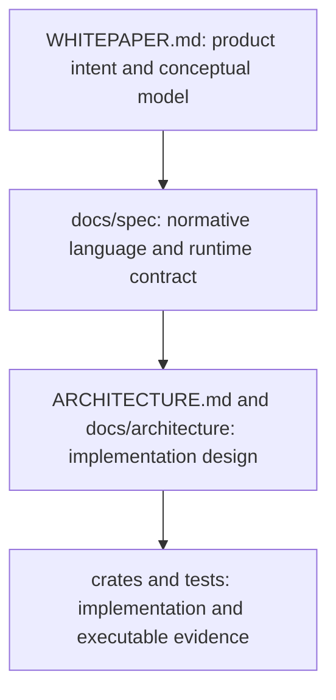

If architecture or code disagrees with the specification, the
specification wins. A semantic change must update the specification,
architecture, implementation, and verification evidence together; an
architecture document must never silently redefine the contract.

## Current executable foundation

The architecture has grown from the first mechanical proof without creating a
second engine:

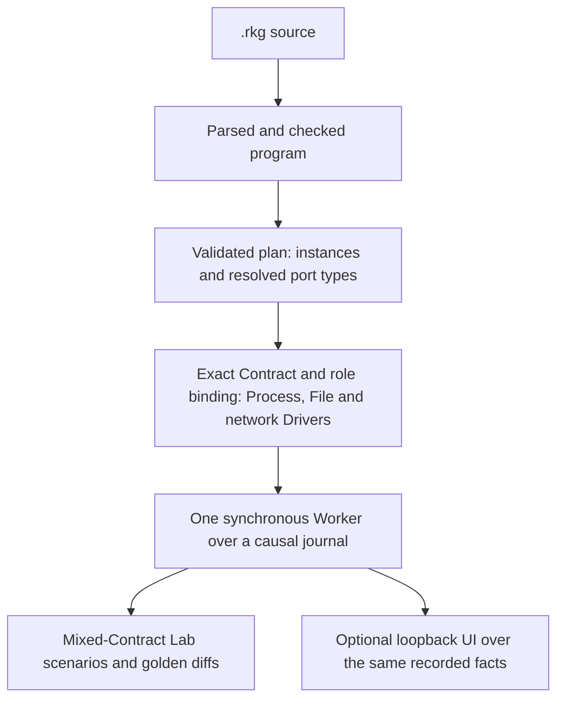

The original proof remains in
[`docs/architecture/m0-exit-report.md`](docs/architecture/m0-exit-report.md);
the current state and evidence are indexed by
[`docs/architecture/m1-slice.md`](docs/architecture/m1-slice.md).
[`ROADMAP.md`](ROADMAP.md) remains the source for milestone gates.

The current slice does not require clustering, a durable disk journal, a live
Saga manager, a complete Connector catalogue, a plugin loader, a remote web
console, or enterprise deployment features. The local optional `--ui` surface
is deliberately not a remote administration plane. Those capabilities
must grow from demonstrated boundaries rather than be represented by
empty crates.

## Architectural shape

Rastok uses a deterministic semantic core surrounded by explicit effect
boundaries:

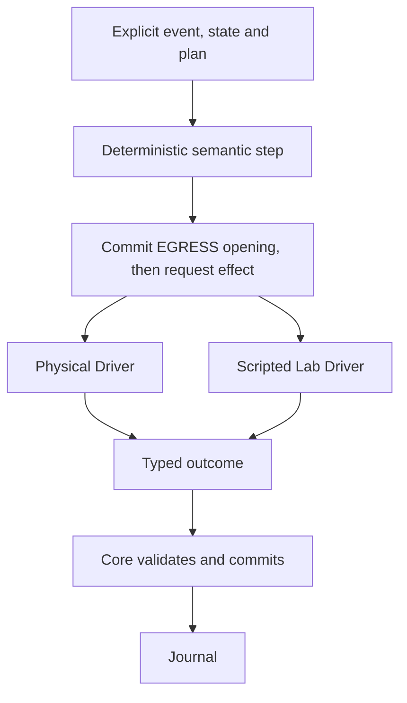

The App and Lab interpret the same checked plan. The semantic core does
not read the wall clock, environment, randomness, filesystem, or
network implicitly. Such observations enter through typed inputs or
effect outcomes and can therefore be recorded and replayed.

## Logical responsibilities

These are responsibilities across `rastok-core` and `rastok`, not a
promise of one crate per box:

| Responsibility | Owns | Must not own |
|---|---|---|
| Source front end | parsing `.rkg`, source spans, syntax diagnostics | runtime effects |
| Semantic checker | names, types, graph validity, Extension and disposition constraints | host I/O |
| Planner and canonicalizer | immutable executable plan, stable identity and ordering | live execution state |
| Runtime core | shared Executor transitions, Extension-manager transitions, scheduling decisions, effect intents | direct host calls or Graph application handlers |
| Hosted Worker | one Execution, its journal and bound Drivers; continuous running, running until idle, and single stepping | an implicit clock, scenario assertions, presentation or new parallelism |
| Read-only execution inspection | detached instance, mailbox, Call and Session views, with execution indexes resolved to paths | journal authority, mutation, formatting or debugger navigation |
| Journal boundary | ordered typed inputs and outcomes | hidden semantic decisions |
| Runtime Connector binding | Contract/mode-compatible implementation selection per Node before Execution/journal construction; exact Driver-object exchange ownership | compiler catalogue or first-registration-wins selection |
| Process, File and network Drivers | physical external interactions behind typed Contracts; flat contract-specific modules own binding and private `network` owns sockets/TLS/protocol engines | general runtime semantics, compiler schema projection or journal authority |
| Project schema tooling | strict OpenAPI discovery/projection and deterministic generated Rastok source | a second runtime type system or authored-source mutation |
| Lab runner | controlled Driver scripts, virtual inputs, time and assertions; authored crash/restart remains deferred | a second execution engine |
| Visual simulation debugger | paused transition controls and projections of validated topology, execution inspection, journal observations and accounting | a second execution authority, durable history, editing, remote administration or unredacted classified data |
| Diagnostics and golden diff | stable human-facing evidence | mutation of execution |
| Diagnostic recording | bounded lossless capture of retained records and offline read-only reconstruction, optionally in the debugger | write-ahead durability, automatic restart, producer re-execution or unqualified personal-data persistence |

The component-level blueprint refining this table, with owned data forms,
interfaces, dependency direction and current status per component, is
[`docs/architecture/components.md`](docs/architecture/components.md).
The working map from specifications to these responsibilities is in
[`docs/architecture/spec-to-code.md`](docs/architecture/spec-to-code.md).

## Dependency direction

Dependencies point toward semantic data and pure decisions:

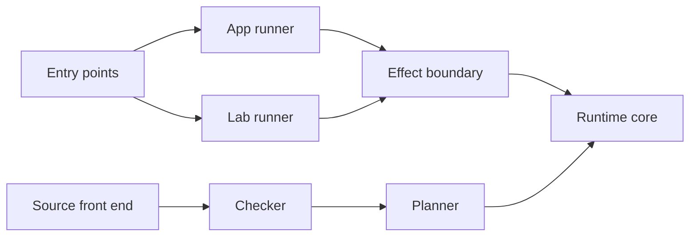

Connector Drivers depend on boundary contracts. The semantic core never
depends on concrete Driver implementations.

Shared types should be owned by the layer that defines their invariant,
not collected in a generic utility module. Queued or potentially
durable values are owned data. Errors remain typed until the outermost
presentation boundary.

## Boundary rules

1. **One engine, two interpretations.** App and Lab do not fork the
   planner or runtime semantics.
2. **Effects are values before they are actions.** The core emits an
   intent and commits its obligation; only then may a Driver perform an effect
   and return a typed outcome. Drivers never write the journal.
3. **Nondeterminism is explicit.** Time, randomness, environment, and
   external responses cannot enter through ambient APIs.
4. **Identity is canonical.** Stable identifiers and hashes derive only
   from the canonical forms defined by the specification.
5. **Recovery is journal-relative.** The Execution reconstructs retained routes,
   state, exchanges, deadlines and Loop commands without rerunning producers.
   A physical durable-journal backend remains separate future work.
6. **Abstractions earn their place.** A trait, generic parameter, crate,
   or dependency needs a present boundary or test seam. Repetition is
   preferable to a false abstraction.
7. **Safe Rust in the workspace.** `unsafe` is forbidden. The documented
   bare-metal spike exception stays outside the workspace and never ships.

## Crate policy

The std/compiler/Driver layer stays in the `rastok` crate while its real
dependency graph is being discovered. A responsibility becomes a separate crate only
when at least one concrete pressure exists:

- independent reuse by another executable;
- a dependency that must not leak into the semantic core;
- a compile-time or ownership boundary that improves correctness;
- a separately testable protocol with a stable public surface.

Splitting by architectural noun alone is not sufficient. Compiler and
runtime crates, once justified, remain in this repository so that
specification, implementation, and conformance changes can be atomic.

The first split happened at M0.5 under exactly this rule:
`rastok-core` (no_std + alloc: vocabulary, envelope, expressions, plan,
journal, boundary, machine) separated from the std layer when the
"dependency that must not leak" pressure became concrete: the OS
must never enter the kernel, and a bare-metal target must be able to
run the same engine. The frontier is machine-checked: CI builds
`rastok-core` for Cortex-M33, Cortex-M3 and RV32IMAC on every push, and the std crate
re-exports the kernel so callers see one surface.

M1.3 deliberately revisits one name and ownership boundary inside that
crate: Rastok's canonical logical `DataType`/`Value` moves to the core,
while the CEL-compatible machinery becomes the `expr` consumer of that
domain. JSON Schema, Avro and Arrow adapters stay in the std/boundary
layer; their library types never leak into the no_std kernel. See the
[M1.3 backlog](docs/architecture/m1.3-type-system-backlog.md).

M1.6 H4.1 extends that same core algebra with the open canonical
`media_type` scalar. OpenAPI remains a hosted compiler/tool adapter:
`serde_json`/`serde_yaml_ng` and filesystem discovery stay in `rastok`, while
only resolved `DataType` trees and categorical plan data cross toward the
core. Connector modules are organized by Contract; a shared module is named
for its real responsibility (`websocket_protocol` or private `network`) rather
than becoming a generic utility bucket.

M1.6 H7 closes the hosted boundary without widening the core interface. One
feature-selected `hosted_registry` composes Process, optional File and the
linked HTTP/WebSocket Connector implementations. HttpClient/HttpServer remain Calls;
WebSocketClient/WebSocketServer use the generic Session fold over H1 Upgrade
and H2/H3 Extended CONNECT. Tokio and every protocol-library type remain
private to `rastok::connector::drivers::network`; the same core still builds for the
three established no-std targets.

M1.7 proved temporal recursion on that deterministic boundary using the v14
Graph-Aspect form retained by v15. Its public Lab and Cortex-M33 evidence
remain recorded in the
[M1.7 exit report](docs/architecture/m1.7-exit-report.md), but
D-2026-09-05-1 supersedes its live ontology. V16 keeps fuel,
proof, explicit logical time and journal authority while making Graph passive,
sharing execution mechanics between Operator and Connector, and moving
Next/Again/Done into durable manager commands outside the spatial DAG. See the
[R0 algebra](docs/architecture/rework-r0-algebra.md) and
[R1 host contracts](docs/architecture/rework-r1-host-contracts.md).

The optional `hosted-ui` feature embeds one loopback HTTP/SSE debugger for
simulation. Next transition invokes existing Execution work or an authored Lab action,
never a second execution model. An authored `advance` retains individually
inspectable intermediate Execution transitions through the same advance cursor as
batch execution; it does not compress ready transactions into one UI frame.
Immutable snapshots retain history, current
mailbox contents, instances, Loop-run dependencies and redacted values.
M1 retains individual measurements without a report engine (D-2026-09-16-7).
Manager commands are not rendered as spatial edges. Reset
creates a fresh session; historical inspection neither forks nor executes it.
Capabilities, controller ownership, browser revisions, presentation speed and
port numbers enter no package, semantic or causal identity. Reduced and
embedded builds omit the server and assets entirely. Real-I/O experiment
debugging remains a separate gate; `run --ui` refuses before effects.

## Views

These inline views describe the implementation. The specification remains
the authority. Selected fields and relationships are not a complete API.

### System context

People and external systems around Rastok.

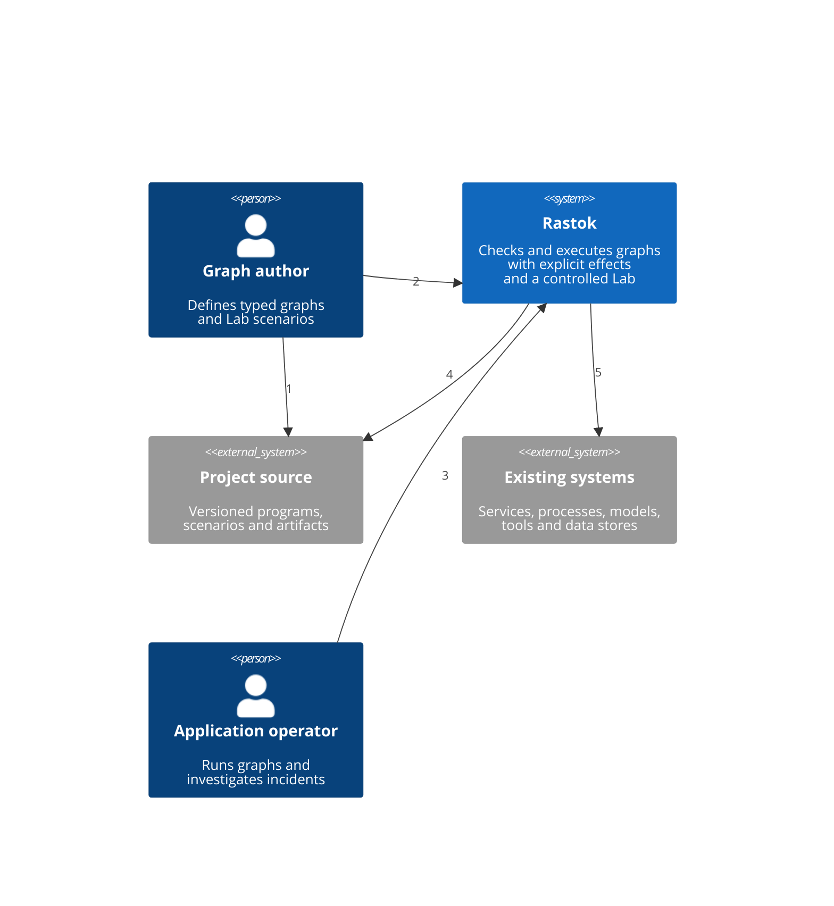

| Relation | Meaning |
|---|---|
| 1 | The author writes project source and scenarios |
| 2 | The author checks, simulates and inspects through the CLI or local browser |
| 3 | The operator runs and diagnoses through the CLI |
| 4 | Rastok reads source and writes review artifacts |
| 5 | App effects reach existing systems through Connector Contracts |

### Container view

The current executable and optional local browser boundary, with local
control separated from external exchanges for readability.

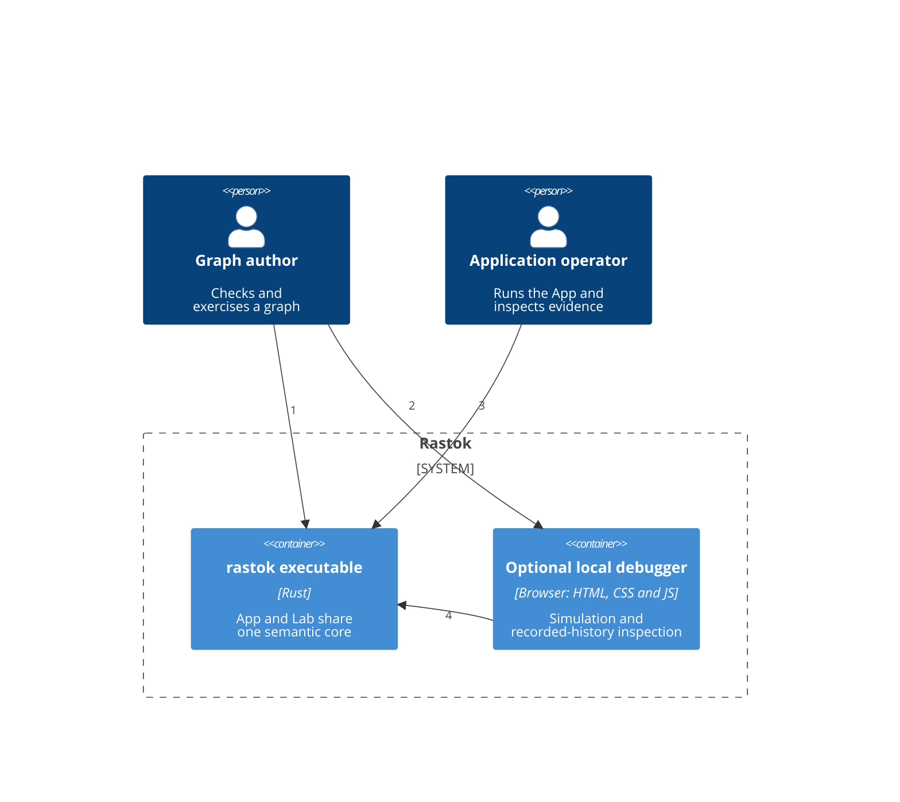

| Relation | Meaning |
|---|---|
| 1 | Check, run and simulate through the CLI |
| 2 | Run and diagnose through the CLI |
| 3 | Inspect and step a simulation |
| 4 | Control and read recorded snapshots through loopback HTTP and SSE |

The browser requires capability and controller checks. It exposes source,
mailboxes, instances and original measurements, not authoring, branches or
real-I/O debugging. Simulation replaces physical effects with controlled Drivers.

The same executable reads project artifacts and performs committed effects
through the selected physical Drivers.

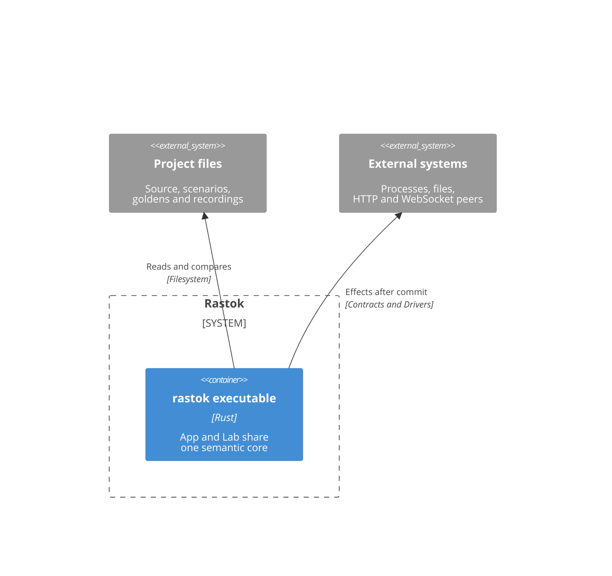

### Component view

Logical responsibilities inside the executable.

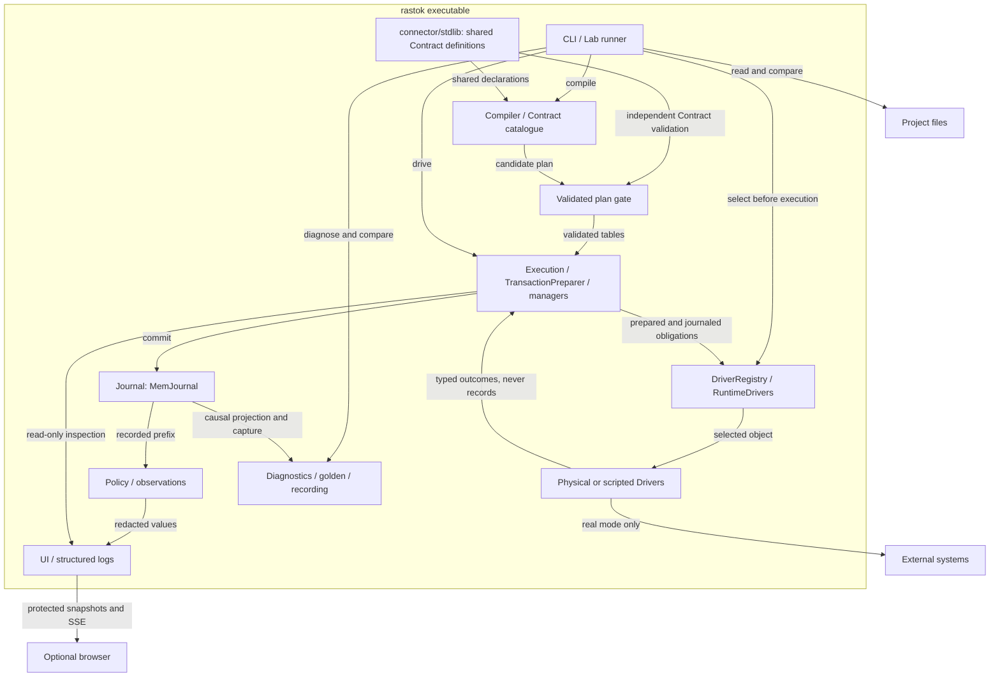

The shared Contract definitions supply ports, attributes, modes and exchange
obligations. Plan validation independently checks scopes, routing, Dispatch,
instance commands, annotations, Loop proofs and Retry safety. RuntimeDrivers
selects a compatible implementation explicitly or by uniqueness and retains
exact exchange ownership. Execution reserves capacity before commit.

MemJournal has no disk backend. Policy and observation code derives individual
measurements from recorded facts, not a second accounting ledger or report
engine. The UI and structured logs present read-only evidence. Diagnostic
recording is an immutable capture, not durable recovery.

### App/Lab effect cycle

Commit-before-effect with real or scripted Drivers, shown first through Call
opening and then through response settlement.

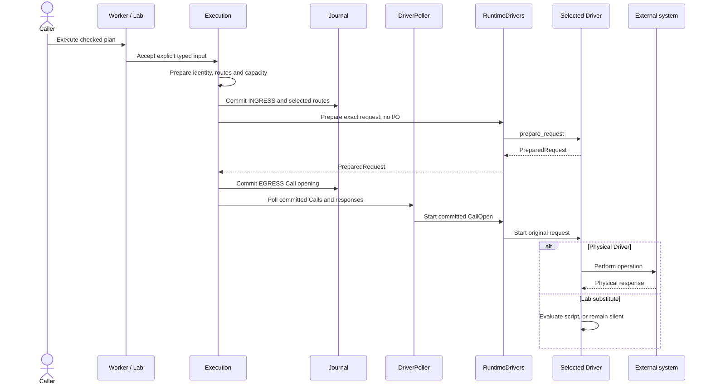

For a returned response, the selected Driver and Contract are checked before
Call closure; publication waits for a separate Connector transaction.

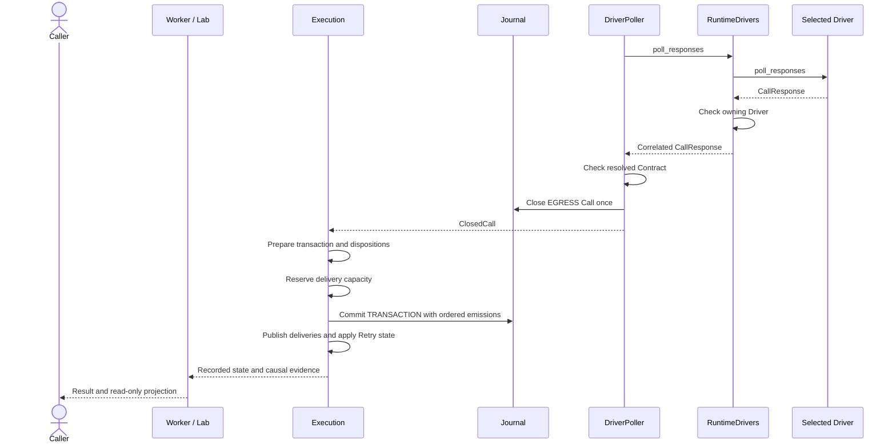

A closed Call waits if its transaction cannot reserve capacity. A timeout
is an execution decision, not a Driver response. An outbound result is not
a new INGRESS root. Retry-held emissions are journaled but not delivered to
the graph. Every exchange stays with its selected Driver object. Drivers
never assign envelope identities or write records. Recovery does not repeat
an already opened external operation.

### Core data forms

Selected implemented types and their ownership relationships, aligned with
the [current format registry](docs/spec/identity.md).

Envelopes carry typed data and metadata; instance generations identify the
owners of live deliveries.

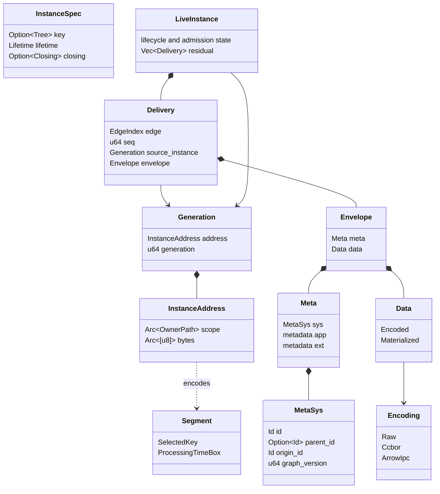

`InstanceSpec`, `InstanceAddress`, `Segment`, `Generation` and `LiveInstance`
belong to `instance`. The last is crate-private ephemeral state, not journal
authority. `Encoded` holds its encoding, shared `Arc<[u8]>` bytes and a lazy
value cache. The cache is not identity. Graph-born values use canonical CBOR;
raw bytes remain external. The reader's port selects bytes or checked UTF-8
text. `EdgeIndex` is local to one Execution. `DeliveryRoutes` resolves its
arrival port and canonical cursor path. Journal records keep paths and exact
instance generations, never these execution indexes.

The journal owns three record kinds and the original deadlines needed to
reconstruct execution.

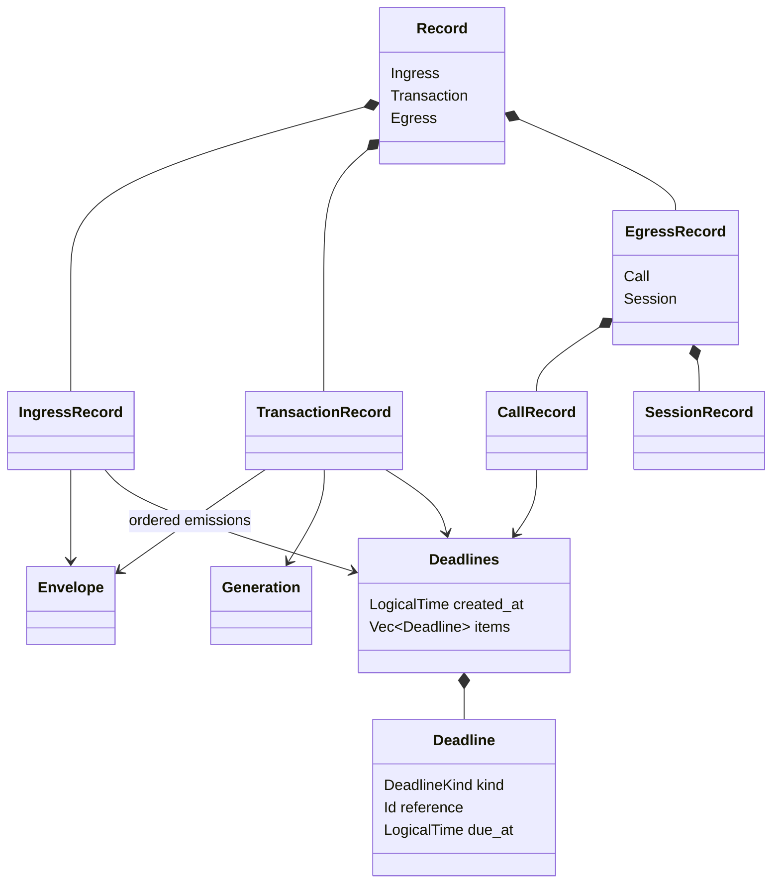

| Record | Selected fields |
|---|---|
| `IngressRecord` | Envelope, source, sequence, ingress port, routes, instance commands, inbound exchange, unsealed deadlines |
| `TransactionRecord` | Owner, instance, trigger, consumed positions, state delta, ordered emissions, routes, deadline ids, Loop/Retry/closure facts, optional observed `Timestamp`, unsealed deadlines |
| `CallRecord` | Intent, status, Retry context, unsealed `closed_at` and deadlines |
| `SessionRecord` | Connector path, session id and status |

INGRESS, TRANSACTION and EGRESS are append-only facts. The first two record
bodies are boxed, as are the Call and Session bodies of EGRESS. Call opening
and closure are separate records. Unsealed instants are recovery evidence,
not causal-seal input. `LogicalTime` counts nanoseconds from logical zero,
not the Unix epoch. The unsealed journal header keeps the immutable civil
origin. An observed `now()` seals origin plus logical time as a civil
`Timestamp` pair.

The canonical tag registry, byte discipline and lossless record codec have
separate responsibilities.

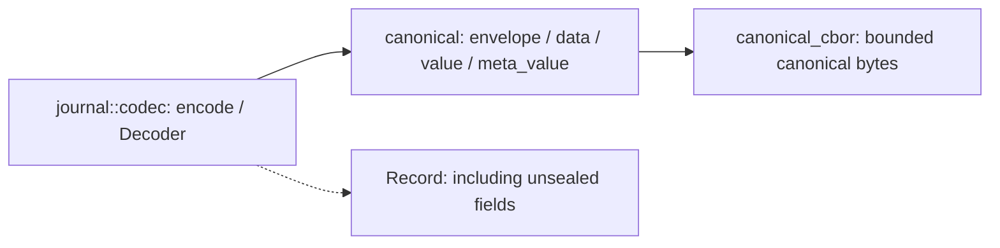

`canonical` owns the shared tag registry. `canonical_cbor` knows neither
journal nor value tags. These types and modules all belong to `rastok-core`.

### Module overview

Current Rust modules, their load-bearing types and the one-way crate
dependency. The component view above shows execution relationships.

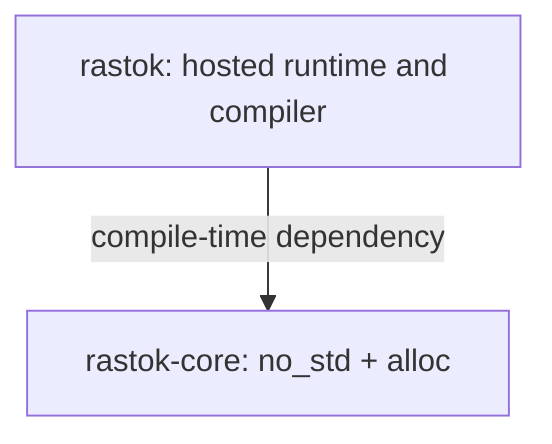

The inventory stays in tables so module names remain readable. The core
never imports the compiler, Lab, browser, network libraries or OS APIs.

| Hosted modules | Responsibility and load-bearing types |
|---|---|
| `main`, `render`, `diagnostics` | CLI assembly, source spans and named errors |
| `compiler` | Syntax, HIR, check and lower; Dispatch, routing and Extension checks |
| `connector/contract`, `connector/stdlib`, `connector_catalogue` | ContractCatalog, shared core declarations, human and JSON projections |
| `contract`, `stdlib` | Tagged frontends, annotations and media types |
| `schema_projection`, `openapi` | Strict JSON Schema, Avro, Arrow and OpenAPI projection; generated-source ownership |
| `connector/drivers` | DriverRegistry, RuntimeDrivers, conformance and physical implementations; no DSL in Drivers |
| `deployment_config` | Profile JSON, per-Node implementation selection, explicit environment/provider input; no clear credentials in semantic artifacts |
| `lab` | Simulator, controlled Drivers, the same Execution and exact Contracts |
| `worker` | Worker owns Execution, journal and bound Drivers; `run`, `run_until_idle`, `step`; explicit time, no new parallelism |
| `ui`, `observability` | Simulation and recorded-history debugger, read-only prefixes, nonblocking structured logs |
| `golden`, `recording` | Trace, Divergence, diagnostic record/replay; immutable capture, not durable recovery |

| Core modules | Responsibility and load-bearing types |
|---|---|
| `node`, `connector` | Path, Port, Kind, Extension, Trigger, ContractId, direction, ExchangeKind and modes |
| `datatype`, `value`, `envelope` | DataType, Value, Envelope and Data; one logical type/value authority |
| `expr`, `json`, `trivia` | Tree, Signature, EvalValue, bounded pure evaluation and exact readers |
| `instance`, `canonical`, `canonical_cbor` | InstanceAddress, Segment, Generation, canonical registry and byte discipline |
| `plan`, `loop_proof` | ValidatedExecutionPlan, Node/NodeIndex, Graph wiring, Operator Dispatch, Connector Contract, ExtensionSpec, LoopSpec/LoopExpiredOutput, RetrySpec; derived routes and independent validation |
| `runtime` | Execution, TransactionPreparer, Mailboxes, Scheduler, DeliveryRoutes, managers and recovery; `execution/driver_polling` owns polling and completion checks |
| `runtime/execution/inspection` | ExecutionInspection, EnvelopeView, read-only instance/mailbox/Call/Session views; no presentation or scheduling authority |
| `connector/driver`, `connector/exchange`, `connector/stdlib` | Per-Driver interfaces, OutboundDrivers routing, CallOpen, Completion, CallId, SessionId and portable Contract definitions |
| `journal` and its protocol, deadline and codec modules | Journal, MemJournal, Record, runs, Held/Consumed/Published, instance commands and original deadlines; no disk backend |
| `schema_annotation`, `data_policy` | SchemaPath, four standard annotations, typed metadata, independent propagation and redaction |
| `deployment` | BootReference, BootBindings, SecretName and run-scoped privacy/price attestations |
| `observation`, `accounting` | RecordObservation, Measurement, individual exact samples and provenance; no report or automatic pricing |

### Semantic model

Node ownership, passive Graph scopes, Executors and temporal managers.

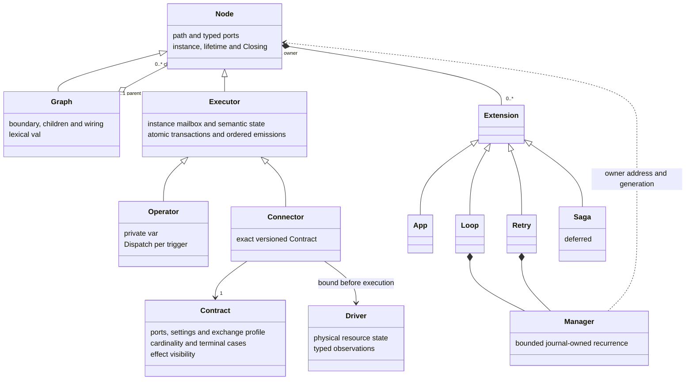

These categories do not imply a public Rust trait per box. Graph has no
application mailbox, `var` or handler. Generic lifecycle records can name a
Graph without becoming Graph application transactions. Connector has no DSL
handler or `var`. `instance.stop` closes the current generation;
`child.instance.stop` targets a direct child. Both are recorded commands,
not spatial ports.

| Extension | Ownership and limits |
|---|---|
| App | Exactly one root Graph, no manager |
| Loop | Operator, Graph or finite outbound Call host; entry, terminals, fuel/measure, delay and Loop.state; LoopExpired uses the resolved existing host terminal, not a contributed port |
| Retry | Same prepared outbound Call request, bounded attempts, terminal cases and delay; no commands, ports or new terminal; all attempts recorded, only the final one delivered |
| Saga | Deferred; no live manager |

Managers perform journal-owned temporal admission, not a PhysicalEdge.
Retry backoff starts at the unsealed Call closure instant. Idempotence is a
plan guarantee, not a CallOpen field. Drivers never write the journal.
Process job is a finite Call; service is a resident Session per instance.
Session frames are fresh admitted INGRESS facts.

## Decisions intentionally left open

The blueprint does not yet select:

- the physical durable-journal layout and recovery deployment;
- a serialized plugin manifest syntax, loader, trust policy or native ABI;
- a public embedding API beyond the current library surface.

Each decision should be made at the smallest point where executable
evidence exposes its real constraints, and then recorded here or in a
focused architecture note.
