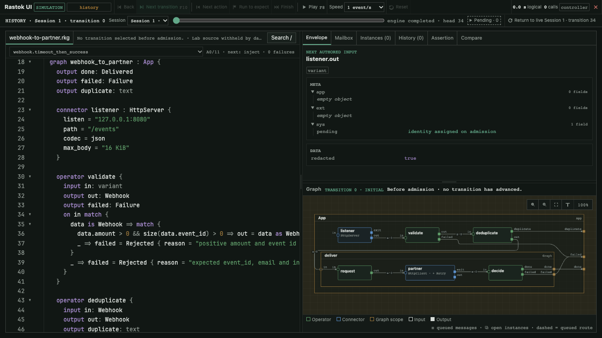

# Rastok

[](https://github.com/rastok-io/rastok/actions/workflows/ci.yml)
[](LICENSE)
[](rust-toolchain.toml)
[](https://docs.rastok.com)
<!-- Enable once `cargo publish` has run on 5 November 2026:
[](https://crates.io/crates/rastok)
-->

**Simulation-first integration platform: a typed flow language, a runtime
and a Lab to build and prove integrations before their systems exist.**

<!-- Public narrative: rastok-strategy/NARRATIF.md,
     "Version courte de référence, deux paragraphes", English block, 77c4637.
     Keep this copy verbatim; propose wording changes in the source. -->

> An integration rarely fails on the happy path. It fails on the edge
> cases: partners not ready, late or duplicate replies, implicit contracts,
> test scenarios that drift. With large language models and AI agents,
> writing a flow has never been faster; proving it will hold in real
> conditions has become the real bottleneck. **Rastok is a simulation-first
> integration platform.** An application's flows, their contracts and their
> failure scenarios are written together, in a dedicated, typed language
> versioned in Git. The test environment is source code: partner faults,
> delays and silences are written next to the program. The *same* program
> runs first in a simulated world, then, without a rewrite, in the real one.
> You build and prove an integration before the partner systems are
> available.
>
> Every run leaves a journal that can be replayed without repeating its
> external effects. An incident becomes a scenario that protects the next
> changes. The journal is also a record an auditor can read. Before anything
> runs, you know which systems will be called, under which conditions, and
> to what end. The compiler refuses a flow that leaves an outcome with
> nowhere to go. A scenario proves the flow holds against the partner as
> described; acceptance, with the same program, checks the description.
> What an assistant writes goes through the same compiler and the same
> scenarios as what a human writes; review focuses on the contracts and the
> scenarios.

Rastok is an Apache-2.0 runtime and a dedicated domain-specific
language (DSL) for stateful, effectful integration graphs. The DSL is
textual, typed, readable in code review, easy to version in Git, and
constrained enough for an LLM to generate without hiding the result
behind a visual low-code format.

The narrative describes the product vision. Rastok is an experimental alpha:
the implemented scope is listed under
[Status and known limits](#status-and-known-limits), and the runtime makes no
production-readiness claim.

Public destinations for the planned **5 November 2026** opening:
[website](https://www.rastok.com) ·
[documentation](https://docs.rastok.com) ·
[source](https://github.com/rastok-io/rastok) ·
[releases](https://github.com/rastok-io/rastok/releases).
These addresses are confirmed; this checkout does not claim that the private
repository or release downloads are already publicly available.

## A first graph

`rastok new hello` writes this file. The graph is the program; the `lab` is
its executable specification, versioned with it.

```rastok
graph hello : App {
  input in: text
  output out: text

  operator greet {
    input in: text
    output out: text
    on in { out = "Hello, " + data }
  }

  in -> greet -> out
}

lab hello {
  scenario roundtrip_greeting {
    app.in = "world"
    expect app.out == "Hello, world"
  }
}
```

```sh
$ rastok check hello.rkg
ok: 2 node(s), semantic hash 6c3cb3abbbfc726fe79f850d6b5d6489e02e89ee545c706378466a7d9f6c6879
$ rastok simulate hello.rkg
PASS hello.roundtrip_greeting
1 scenario(s), 0 failed
```

Change the expected text and run `simulate` again: the scenario fails and
reports the expectation and the deliveries it saw. Add `--ui` to step through
the same run in the debugger.

## Quickstart

<!-- quickstart:start -->
Release archives for macOS Apple silicon and Linux x86-64 are attached to
[v0.1.0-alpha](https://github.com/rastok-io/rastok/releases/tag/v0.1.0-alpha),
each with a `.sha256` file. On any platform with Rust **1.97.1**, install from
crates.io instead. Both give HTTP/1.1, HTTP/2, WebSocket and the debugger, not
HTTP/3.

```sh
cargo install rastok --version 0.1.0-alpha --locked --features hosted-ui,hosted-websocket
rastok new hello
rastok simulate hello.rkg --ui
```

Open the loopback URL printed by the last command, including its access token.
The simulation starts paused. Choose **Next transition**, or **Finish** to
reach `Hello, world`. The CLI reports `PASS hello.roundtrip_greeting` when the scenario
finishes. Close the viewer from its toolbar when done.
<!-- quickstart:end -->

The [Getting Started page](docs/site/getting-started.md) owns this block. Continue with
the [learning path](docs/site/getting-started.md#three-ways-to-learn): eight examples, from
[echo](docs/site/examples/01-echo.md) to agents and a
[typed HTTP model adapter](docs/site/examples/08-model-adapter.md), each with a
scenario to break.

## See it run



Native Retry in the debugger: a webhook is acknowledged, the partner call
times out, a bounded retry is scheduled and the second attempt succeeds, all
rendered from recorded simulation transitions. The
[chapter](docs/site/examples/04-webhook-to-partner.md) explains the inputs,
the recorded transitions and the visible limits.

## What you get

- **A typed graph language.** Graphs compose Operators (pure logic) and
  Connectors (declared effect boundaries) with static wiring. The compiler
  checks types, ports and routes before anything runs.
- **A Lab in the same source.** Simulations script the outside world with
  mocks, virtual time and faults. Scenarios are versioned with the graph and
  compared with golden traces.
- **One journal that explains each run.** Every transaction and boundary outcome is recorded with the decision and the input that caused it.
  A run is a function of the graph and its journal, so it can be replayed and
  compared record by record.
- **A paused visual debugger.** `simulate --ui` steps through recorded
  transitions with mailboxes, instances, decisions and causal links.
  `replay --ui` opens a recorded real run without repeating its effects.
- **Standard Connectors.** Process (job and resident service), File,
  HttpClient and HttpServer over HTTP/1.1, HTTP/2 and HTTP/3, WebSocket client
  and server. Supported Lab modes run without the network; a declared
  Contract does not imply that every mode has a scripted twin.
- **Native Retry, Loop, keyed instances and lifetimes**, checked statically
  and reconstructed from the in-memory journal on recovery.
- **Data annotations.** `@sensitive`, `@secret`, `@personal` and `@measure`
  travel with the schema; the CLI and debugger redact protected fields
  before presentation. Diagnostic recordings are not redacted exports.
- **A small, portable core.** `rastok-core` holds the semantics, builds
  without the standard library and is checked on bare-metal targets in CI.
- **Editor support.** A data-only VS Code and JetBrains TextMate grammar in
  [`editors/vscode/rastok-dsl`](editors/vscode/rastok-dsl/README.md).

## How it works

A Rastok graph connects existing services, models, tools, data, and
business processes. In the current model, a Node is either
a passive Graph scope or an Executor:

- **Graphs** compose a typed boundary, children and static wiring. They own
  instance/lifecycle scope, but no application mailbox, handler or transaction.
- **Operators** are Executors whose transitions are authored as typed DSL
  Dispatch. They may update private `var` state but perform no external I/O.
- **Connectors** are Executors. Each has one exact versioned **Contract**;
  its transition comes from that Contract and typed Driver events. Connectors are the explicit boundaries
  to external systems. The alpha supplies HTTP, WebSocket, Process and File
  Contracts; database, broker and time-source Connectors remain future work.

An **Extension** is attached to one Node and may contribute attributes,
bindings, commands, constraints and, only when necessary, ports. `App` marks
the one public root Graph; `Loop` adds finite iteration through a
journal-owned manager; `Retry` repeats the same outbound Call under a
bounded, statically checked policy; `Saga` remains a future Extension. A manager is neither
a Node nor an edge, so iteration and retry never create a spatial cycle.
Loop contributes no port: exhaustion is a `LoopExpired` case on the host's
resolved failure terminal (`err`, a custom terminal, or a Call's `exit`).

This separation makes effects replaceable. With physical Drivers, Connectors
interact with real systems. In a simulation sandbox called the
**Lab**, controlled Driver scripts replace those external systems while the
same Operators and the same checked graph continue to run.

The Lab controls inputs, time, boundary outcomes, and faults. A
production incident captured in a recording can be replayed locally without
repeating its real-world effects. An author can then write a Lab scenario,
test a fix, and compare golden traces; automatic conversion remains future work.

### Same program, different world

Rastok separates semantic decisions from effect execution:

```text
step(plan, state, event) -> (new_state, effect_intents)

Driver execution: effect_intents -> real outcomes
Lab simulation : effect_intents -> controlled outcomes
```

Boundary outcomes return as typed, journaled events. Rastok does not
pretend that effects are pure. It makes them visible, isolated, and
substitutable.

Readers from functional programming may recognize a deterministic core
surrounded by explicit effect handlers. Rastok does not expose monads
or require a functional language; it preserves the useful engineering
property.

## Command line

| Command | What it does |
|---|---|
| `rastok --help`, `rastok -h`, `rastok help` | prints command syntax on stdout and exits successfully |
| `rastok --version` | prints the compiled package version on stdout and exits successfully |
| `rastok new <name>` | writes a starter graph and its Lab to `<name>.rkg` |
| `rastok check <file.rkg>...` | compiles the unit and prints its Node count and semantic hash |
| `rastok simulate <file.rkg>... [--compare <dir> \| --save <dir>] [--ui]` | runs every Lab scenario; compares with or saves golden traces; serves the debugger |
| `rastok run <file.rkg>... [--file-root <dir>] [--deployment <profile.json>] [--json-logs] [--record <file.rkr>]` | runs the App against real Drivers, one stdin line per submission |
| `rastok replay <file.rkr> [--ui]` | reconstructs a recorded run without Driver I/O |
| `rastok connectors [--json]` | lists the standard Contracts, modes, ports and installed implementations |
| `rastok --resolve-open-api <project-dir> [--check]` | generates typed endpoints from OpenAPI 3.0 and 3.1 documents |

Rastok uses `.rkg` for source, `.rkp` for compiled plan packages,
`.rkc` for causal reference traces, and `.rkr` for diagnostic recordings.

The [Command line chapter](docs/site/guide/09-command-line.md) explains every
command, its options, output streams and exit statuses. The
[implementation status page](docs/architecture/m1-implementation-status.md)
records the deployment, recording and golden-trace qualification limits.

## Status and known limits

> **Status on 5 November 2026, v0.1.0-alpha.** Today: the language, the
> compiler, the runtime, the standard connectors and the Lab, virtual time
> and injected faults included; the journal, recorded runs and their replay,
> golden traces; eight runnable examples, from echo to agents. Next:
> durable recovery after a stop (end of November); an incident turned into a
> scenario in one step (mid-January); taking over a slice of an existing
> integration (February); agents under approval, refusal and budgets
> (April). Gains from AI generation remain to be measured.

Rastok is at an early experimental stage. Its specification and
implementation architecture are under active review, and the runtime
does not yet make a production-readiness claim.

Opening is planned for **5 November 2026**, on explicit release instruction.
The independent HTTP/3 server test against ngtcp2, official Autobahn suite,
and measurement of the work needed to add a Connector remain **open and
non-blocking for that opening**. The debugger's final browser qualification
is still blocking. None is implied by a green Rust test suite. M1 has no
durable deployment journal, Kafka or SQL Connector; diagnostic recordings
are not durable recovery or share-safe exports.

The current package format is 1 and the diagnostic recording format 1, both
registered in [identity.md](docs/spec/identity.md). The current executable
proof is one continuous path:

```text
Rastok DSL source
  -> validated executable plan
  -> deterministic state machine
  -> Execution driven by one hosted Worker and an in-memory journal
  -> mixed real Process and File boundaries selected through one Driver registry
  -> journaled, auditable multi-Contract Lab scenarios with useful golden diffs
  -> optional paused simulation debugger with recorded-transition inspection
```

What is executable today, with its exact limit, is tabulated in the
[white paper](WHITEPAPER.md#10-status) and detailed, milestone by milestone,
in the [implementation status page](docs/architecture/m1-implementation-status.md).
The [opening ledger](docs/architecture/opening-showcase.md) and the
[release-qualification inventory](docs/architecture/release-qualification.md)
distinguish local qualification from the external evidence still open.

## How Rastok is built

> **How Rastok is built.** Rastok is designed and developed by its founder
> with coding agents. The language and the runtime are described in a
> specification kept in the repository, the deterministic core is isolated
> in `rastok-core`, and golden traces are enforced in CI. The human review
> of the core is recorded file by file in the repository and continues; an
> independent Rust review is under way. Known limits are listed in the
> README.

## Documentation

| Document | What it is |
|---|---|
| [WHITEPAPER.md](WHITEPAPER.md) | conceptual model and statement of intent: why Rastok exists, the core model, instances, time and the Lab |
| [docs/spec/](docs/spec/README.md) | the normative language and runtime contract: grammar, types, expressions, envelope, execution model, delivery and simulation semantics, identity, diagnostics |
| [ARCHITECTURE.md](ARCHITECTURE.md) and [docs/architecture/](docs/architecture/) | implementation blueprint, diagrams and qualification ledgers |
| [Learning path](docs/site/getting-started.md#three-ways-to-learn) | the user guide or six hands-on examples, each with a scenario to break |
| [Example catalogue](docs/examples/README.md) | executable programs, isolated fragments and historical sketches, told apart |
| [Connector Driver guide](docs/architecture/connector-drivers.md) | how to contribute a Driver behind a standard Contract |
| [ROADMAP.md](ROADMAP.md) | evidence gates, done and open |

The repository keeps intent, contract, design, and evidence distinct:

```text
WHITEPAPER.md             conceptual intent
        |
        v
docs/spec/                normative language and runtime contract
        |
        v
ARCHITECTURE.md
docs/architecture/        implementation design
        |
        v
crates/ and tests         implementation and executable evidence
```

Architecture and code do not silently override the specification. A
semantic change updates the normative rule, affected architecture,
implementation, and executable evidence together.

## Repository

```text
rastok/
├── crates/                 Rust implementation workspace (rastok-core, rastok)
├── docs/
│   ├── spec/               normative language and runtime contract
│   ├── architecture/       implementation views, diagrams and ledgers
│   ├── examples/           example catalogue and historical sketches
│   └── site/               learning path, quickstart and publication assets
├── examples/               executable graphs with their Labs
├── editors/                VS Code and JetBrains TextMate grammar
├── spikes/                 interop and bare-metal spike crates, outside the workspace
├── tools/                  repository development tools
├── AGENTS.md               engineering rules for humans and agents
├── ARCHITECTURE.md         canonical implementation blueprint
├── CODE_OF_CONDUCT.md      expected project conduct
├── CONTRIBUTING.md         contribution and review policy
├── GOVERNANCE.md           project decision model
├── SECURITY.md             vulnerability reporting policy
├── ROADMAP.md              current evidence gates
└── WHITEPAPER.md           conceptual model and statement of intent
```

Compiler and runtime crates stay together in this workspace. New crate
boundaries are introduced only when the implementation justifies them;
architecture documents do not pre-create empty subsystems.

## Contributing

Read [CONTRIBUTING.md](CONTRIBUTING.md) first: one problem per pull request,
focused tests, a Developer Certificate of Origin sign-off on every commit and
disclosure of substantial machine assistance. [AGENTS.md](AGENTS.md) states
the engineering rules that apply to humans and coding agents alike,
[GOVERNANCE.md](GOVERNANCE.md) the decision model and
[CODE_OF_CONDUCT.md](CODE_OF_CONDUCT.md) the expected conduct. Report
vulnerabilities as described in [SECURITY.md](SECURITY.md), never in a public
issue.

## License

Rastok is licensed under the Apache License 2.0. The Rastok name
and official artifacts are covered separately by the trademark policy
([TRADEMARKS.md](TRADEMARKS.md)); [OPEN_SOURCE_COMMITMENT.md](OPEN_SOURCE_COMMITMENT.md)
records the project's licensing commitments.
The simulation debugger embeds the JetBrains Mono typeface under the SIL Open
Font License 1.1; the license text is in
[crates/rastok/src/ui/fonts/OFL.txt](crates/rastok/src/ui/fonts/OFL.txt).
