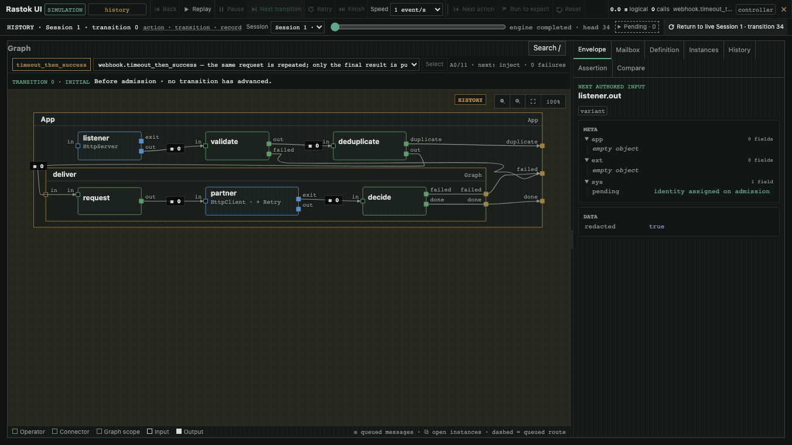

# Rastok

> Integrate AI faster. Keep production calm.

Rastok is an Apache-2.0 runtime and a dedicated domain-specific
language (DSL) for stateful, effectful integration graphs. The DSL is
textual, typed, readable in code review, easy to version in Git, and
constrained enough for an LLM to generate without hiding the result
behind a visual low-code format.

Public destinations for the planned **15 October 2026** opening:
[website](https://www.rastok.com) ·
[documentation](https://docs.rastok.com) ·
[source](https://github.com/rastok-io/rastok) ·
[releases](https://github.com/rastok-io/rastok/releases).
These addresses are confirmed; this checkout does not claim that the private
repository or release downloads are already publicly available.

## Quickstart

<!-- quickstart:start -->
Build from the repository with Rust **1.97.1** while release binaries are being
prepared. This installs HTTP/1.1–2, WebSocket and the debugger, not HTTP/3.

```sh
cargo install --path crates/rastok --locked --features hosted-ui,hosted-websocket
rastok new hello
rastok simulate hello.rkg --ui
```

Open the loopback URL printed by the last command, including its access token.
The simulation starts paused. Choose **Next transition**, or **Finish** to
reach `Hello, world`. The CLI reports `PASS smoke.roundtrip` when the scenario
finishes. Close the viewer from its toolbar when done.
<!-- quickstart:end -->

The [public quickstart](docs/site/quickstart.md) owns this block. Continue with
the [opening gallery](docs/site/index.md), starting with
[echo](docs/site/gallery/01-echo.md), then
[webhook to partner](docs/site/gallery/04-webhook-to-partner.md) for a
simulated HTTP flow with typed validation, bounded retries and an audit profile.



Thirty seconds through the simulated flagship. The [chapter](docs/site/gallery/04-webhook-to-partner.md)
explains the inputs, retained transitions and visible limits.

## Model

A Rastok graph connects existing services, models, tools, data, and
business processes. In the current model, a Node is either
a passive Graph scope or an Executor:

- **Graphs** compose a typed boundary, children and static wiring. They own
  instance/lifecycle scope, but no application mailbox, handler or transaction.
- **Operators** are Executors whose transitions are authored as typed DSL
  Dispatch. They may update private `var` state but perform no external I/O.
- **Connectors** are Executors. Each has one exact versioned **Contract**;
  its transition comes from that Contract and typed Driver events. Connectors are the explicit boundaries
  to APIs, processes, databases, files, brokers and time sources.

An **Extension** is attached to one Node and may contribute attributes,
bindings, commands, constraints and, only when necessary, ports. `App` marks
the one public root Graph; `Loop` adds finite temporal recurrence through a
journal-owned manager; `Saga` remains a future Extension. A manager is neither
a Node nor an edge, so temporal recurrence never creates a spatial cycle.
Loop contributes no port: exhaustion is a `LoopExpired` case on the host's
resolved failure terminal (`err`, a custom terminal, or a Call's `exit`).
The categorical v18 package carries recursive Dispatch, case routing,
ordered multi-emission and command-based Operator, Graph and outbound Call
Loops. Independent core validation re-derives their contracts, routes and
proofs. Recovery reconstructs retained deliveries, state, commands, exchanges
and original timer deadlines without re-executing producers or repeating I/O.
Nested runs, same-context joins, annotations and entry-preserving measures
are qualified within the [named Loop proof subset](docs/spec/loop.md#16-deferred-by-name).
The [R9 qualification ledger](docs/architecture/rework-r9-qualification.md)
records the v16 rework; the subsequent
[v17 ledger](docs/architecture/loop-host-terminal-v17.md) records the
host-terminal amendment and its unchanged non-Loop witnesses. The
[v18 closure ledger](docs/architecture/instance-stop-command.md) adds
`instance.stop` and `child.instance.stop`: exact-generation lifecycle requests,
not ports or spatial edges. The subsequent
[resident Process contract](docs/architecture/process-service.md) uses those
commands and the existing Session exchange: one child per instance, streamed
lines/JSONL, and no automatic restart or protocol-specific RPC.

This separation makes effects replaceable. In production, Connectors
interact with real systems. In a simulation sandbox called the
**Lab**, controlled Driver scripts replace those external systems while the
same Operators and the same checked graph continue to run.

The Lab controls inputs, time, boundary outcomes, and faults. A
production incident can therefore become a local scenario: replay the
causal path, test a fix, and compare the result without repeating the
original real-world effects.

## Same program, different world

Rastok separates semantic decisions from effect execution:

```text
step(plan, state, event) -> (new_state, effect_intents)

Driver execution: effect_intents -> real outcomes
Lab simulation : effect_intents -> controlled outcomes
```

Boundary outcomes return as typed, journaled events. Rastok does not
pretend that effects are pure. It makes them visible, isolated, and
substitutable.

Readers from functional programming may recognize a deterministic core
surrounded by explicit effect handlers. Rastok does not expose monads
or require a functional language; it preserves the useful engineering
property.

## Status and known limits

Rastok is at an early experimental stage. Its specification and
implementation architecture are under active review, and the runtime
does not yet make a production-readiness claim.

Opening is planned for **15 October 2026**, on explicit release instruction.
The independent HTTP/3 server test against ngtcp2, official Autobahn suite,
and measurement of the work needed to add a Connector remain **open and
non-blocking for that opening**. The debugger's final browser qualification
is still blocking. None is implied by a green Rust test suite. M1 has no
durable deployment journal, Kafka or SQL Connector; diagnostic recordings
are not durable recovery or share-safe exports. See the
[opening ledger](docs/architecture/opening-showcase.md).

The current executable proof is one continuous path:

```text
Rastok DSL source
  -> validated executable plan
  -> deterministic state machine
  -> state-machine execution in a native in-memory VM
  -> mixed real Process and File boundaries selected through one Driver registry
  -> journaled, auditable multi-Contract Lab scenarios with useful golden diffs
  -> optional paused simulation debugger with retained-transition inspection
```

Connector contracts have stable semantic ids and inbound/outbound roles.
Current binaries compose Drivers explicitly at build/assembly time; minimal,
embedded and full builds may select different sets without changing the plan
model. A future plugin host can use the same registry boundary, but Rastok does
not yet ship a plugin loader or freeze a native ABI. Contributors follow the
[Connector Driver guide](docs/architecture/connector-drivers.md).

M1.6 is closed. Four exact HTTP/WebSocket sheets cross source, Registry-free
plan validation, Lab and live Drivers. HttpClient and HttpServer execute the
same Call contracts over HTTP/1.1, HTTP/2 and HTTP/3. WebSocketClient and
WebSocketServer execute one generic Session over HTTP/1.1 Upgrade, HTTP/2
Extended CONNECT and HTTP/3 Extended CONNECT: complete messages travel in
either direction and one typed `exit` closes the connection. All hosted I/O
runs behind one bounded private pump using Hyper/Rustls, quiche/BoringSSL and
Tungstenite; none of those dependencies enters `rastok-core` or a no-std
build. Static feature presets compose reduced or full Driver registries
without changing plan semantics. The executable
[WebSocket-to-job example](docs/examples/codex-websocket-gateway.rkg) and the
[M1.6 exit report](docs/architecture/m1.6-exit-report.md) record the complete
proof. The single
[release-qualification inventory](docs/architecture/release-qualification.md)
records executed independent HTTP/WebSocket interop and the remaining
ngtcp2/Autobahn qualifications without conflating them with workspace tests.

The later [resident agent gateway](examples/agent-gateway.rkg) keeps one JSONL
child per conversation. Its [gallery chapter](docs/site/gallery/06-agent-gateway.md)
and [evidence](docs/architecture/agent-gateway-showcase.md) distinguish scripted
protocol replies and real local composition tests from public authentication,
live model qualification or per-job usage accounting.

M1.7 is closed as historical v14/v15 evidence: it proved fuel-bounded and
directly ranked temporal recurrence, logical delay, typed exhaustion,
concurrent runs and stale-wake fencing without a spatial back-edge. The
[M1.7 exit report](docs/architecture/m1.7-exit-report.md) remains the exact
record of that implementation. D-2026-09-05-1 now supersedes its Graph-handler
and port-shaped control model: v16 makes Graph passive, shares transaction
mechanics between Operator and Connector, identifies a run from its exact
opening admission, and represents Next/Again/Done as durable manager commands.
The frozen [R0 algebra](docs/architecture/rework-r0-algebra.md),
[reference traces](docs/architecture/rework-r0-reference-traces.md), and
[R1 host contracts](docs/architecture/rework-r1-host-contracts.md) lead to the
[R2 review handoff](docs/architecture/rework-r2-supersession.md). The [R9 qualification](docs/architecture/rework-r9-qualification.md)
links that design to the executable host and recovery tests.

M1.8 closed on categorical package v15; its contracts remain in the current
v18 package. The source front end
recognizes the closed `@sensitive`/`@secret`/`@personal`/`@measure`/`@cost` family,
resolves aliases into canonical schema paths and transports the sparse policy
tables through checked HIR, package decode and Registry-free validation.
Invalid or forged annotations refuse by exact path. A3 independently derives
effective policy across copies, projections, calculations, guards, state and
Loop recurrence; accounting meanings never merge ambiguously, and terminal
presentation redacts before formatting. `@personal` remains orthogonal to
confidentiality, preserves the GDPR Articles 9/10 regimes and an exact
data-subject identifier role, and redacts by default. A4 now admits personal
data only with a complete attested run-scoped privacy profile. Exact
`env()`/`secret()` references bind HttpClient URL and bearer settings through
the same real/Lab descriptor; physical secret bytes enter neither source,
profile JSON, CLI, `Value`, package nor journal. Raw incoming `@secret` fields
remain fail-closed. Unannotated semantic
hashes and all existing causal traces remain unchanged. Every causal record
also yields a typed retained observation with exact flow/instance/Call/Session
correlation. `rastok run --json-logs` projects that stream through a bounded
never-block queue; payloads are omitted by default and classified values are
redacted before JSON formatting. Export loss changes neither execution nor
the retained accounting plane. A7 reconstructs a public per-flow
`CostReport` lazily from the same causal records and validated schemas. Token
subset relations prevent cache/reasoning double counting; positive quantities
without a matching deployment price stay `unpriced`. Provider-reported and
pricebook-calculated amounts retain exact decimal values, evidence and
currency, and no cross-currency total exists. Optional Connector/provider/model
price rows live in the deployment profile; only their stable reference and
digest enter the run header, never graph identity or causal bytes. The ordered
work is tracked in the
[M1.8 backlog](docs/architecture/m1.8-observability-backlog.md), and the
[exit report](docs/architecture/m1.8-exit-report.md) owns the identity,
portability and remaining-limit ledger.
The optional OpenTelemetry transport is explicitly deferred until exact
temporal observations exist; no exporter timestamp is presented as commit
time.

The visual debugger is available through `simulate --ui`. It starts paused,
uses the checked scenario on disk, and retains a read-only transition timeline.
Back/forward inspection does not fork or mutate the simulation;
Reset starts a fresh session and preserves the old history. The embedded page
shows real compound topology, current mailbox FIFOs (`≡ n`), instances
(`⧉ n`), source definitions, Loop-run state dependencies, redacted `META`/
`DATA` and the public `CostReport`. Manager commands are described as commands,
never invented ports or spatial edges. Replay presents retained transitions at
one or four events per second. Decisions, causal links, pending obligations
and assertion evidence explain the selected journal prefix. The canvas
pans/zooms and the inspector resizes. One controller limit remains explicit:
an authored `advance` can retain several VM transactions in one transition;
the UI does not claim that every transition is exactly one journal record.

`run --ui` and `check --ui` refuse before effects. Editing, simulation
branches and real-I/O experiment debugging remain separate future work.

Record a real run, then inspect its retained facts without repeating effects:

```sh
printf 'hello\n' | rastok run examples/echo.rkg --record echo.rkrec
rastok replay echo.rkrec
rastok replay echo.rkrec --ui
```

Replay needs neither the source nor the files/processes used by the program.
It reconstructs the recorded state; `simulate` is the command that executes
the DSL against a Lab world. This bounded diagnostic file is not M2's durable
deployment journal. The first slice refuses personal-data persistence and
boot-dependent deployment profiles, never overwrites an existing recording,
and makes no share-safe-export claim. See the
[recording contract](docs/architecture/diagnostic-recording.md) for the exact
format, read-only UI and limits.

See [ui.md](docs/spec/ui.md) and the
[M1.9 backlog](docs/architecture/m1.9-ui-backlog.md) for the presentation and
external visual-qualification boundary.

For hosted execution or simulation, `--deployment <profile.json>` supplies
typed boot values, versioned secret coordinates and the optional privacy
attestation. Secret material itself comes from the selected provider (the M1
provider is the process environment plus a matching `_VERSION` coordinate),
never from a command-line value.

The standalone runner links Process by default. Hosted features add the
selected HTTP/WebSocket Connector implementations through one registry assembly. Pass
`--file-root <dir>` to `rastok run` to add the real File Driver with an
explicit deployment root; that root is neither inferred from the graph nor
part of plan identity.

Pass `--json-logs` to `rastok run` for newline-delimited structured events on
stderr. Boundary outputs remain on stdout. Logging is deliberately lossy under
exporter pressure; the journal-backed report input is not.

For a local paused debugger, build the optional hosted UI:

```sh
cargo run -p rastok --features hosted-ui -- simulate app.rkg --ui
```

Start with a small line-counting simulation: a mocked reader supplies one
header and three data lines, a filter drops the header, and an Operator counts
the remaining lines. This is not a general CSV parser with quoted-newline support.

```sh
cargo run -p rastok --features hosted-ui -- simulate examples/csv-count.rkg --ui
```

The larger executable UI tour combines structured DATA, keyed Loop retries, a nested
Graph, an Operator and a mocked Process boundary:

```sh
cargo run -p rastok --features hosted-ui -- simulate examples/keyed-retry.rkg --ui
```

Add `--ui-port PORT` to request one explicit non-zero loopback port. The CLI
prints the authorized URL and never opens a browser automatically.
The [example catalogue](docs/examples/README.md) distinguishes executable
programs from historical sketches and future-surface illustrations.

For projects described by OpenAPI 3.0 or 3.1, run
`rastok --resolve-open-api <project-dir>` to discover static HTTP endpoints
and deterministically create or update `openapi.generated.rkg`. The command
never rewrites authored sources; `--check` refuses missing or stale generated
types for CI and LLM-driven workflows.

## Documentation authority

The repository keeps intent, contract, design, and evidence distinct:

```text
WHITEPAPER.md             conceptual intent
        |
        v
docs/spec/                normative language and runtime contract
        |
        v
ARCHITECTURE.md
docs/architecture/        implementation design
        |
        v
crates/ and tests         implementation and executable evidence
```

Architecture and code do not silently override the specification. A
semantic change updates the normative rule, affected architecture,
implementation, and executable evidence together.

## Repository

The stable top-level structure is:

```text
rastok/
├── crates/                 Rust implementation workspace
├── docs/
│   ├── spec/               normative language and runtime contract
│   ├── architecture/       implementation views and diagrams
│   └── examples/           graphs and reference simulations
├── tools/                  repository development tools
├── AGENTS.md               engineering rules for humans and agents
├── ARCHITECTURE.md         canonical implementation blueprint
├── CODE_OF_CONDUCT.md      expected project conduct
├── CONTRIBUTING.md         contribution and review policy
├── GOVERNANCE.md           project decision model
├── SECURITY.md             vulnerability reporting policy
├── ROADMAP.md              current evidence gates
└── WHITEPAPER.md           conceptual model and statement of intent
```

Compiler and runtime crates stay together in this workspace. New crate
boundaries are introduced only when the implementation justifies them;
architecture documents do not pre-create empty subsystems.

`LICENSE`, `OPEN_SOURCE_COMMITMENT.md`, and `TRADEMARKS.md` define the
project's licensing and identity commitments.

## License

Rastok is licensed under the Apache License 2.0. The Rastok name
and official artifacts are covered separately by the trademark policy.
