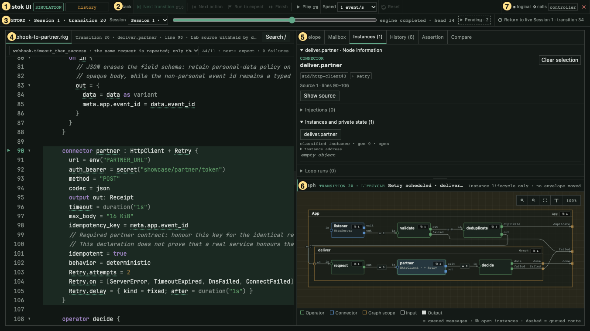
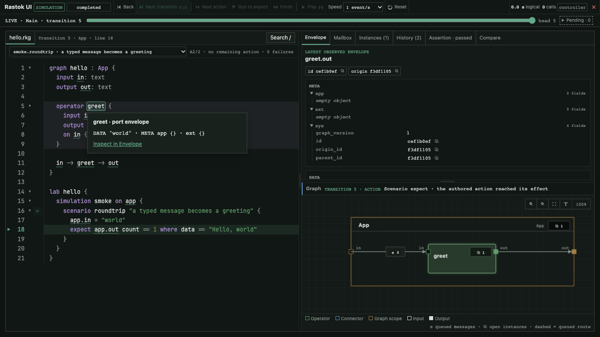
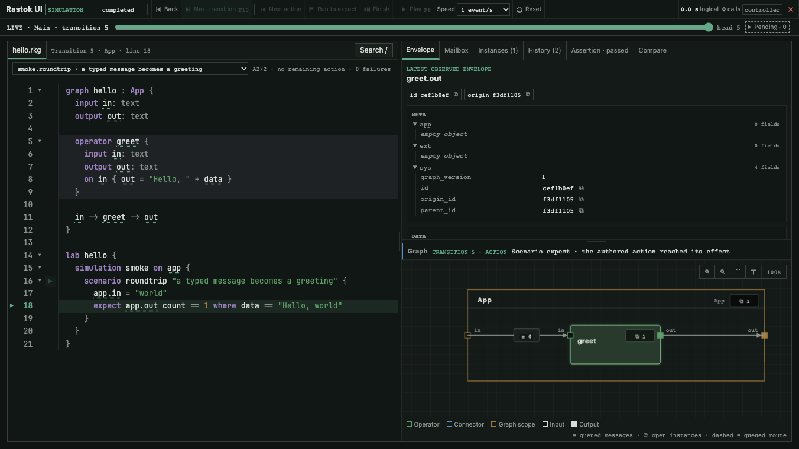
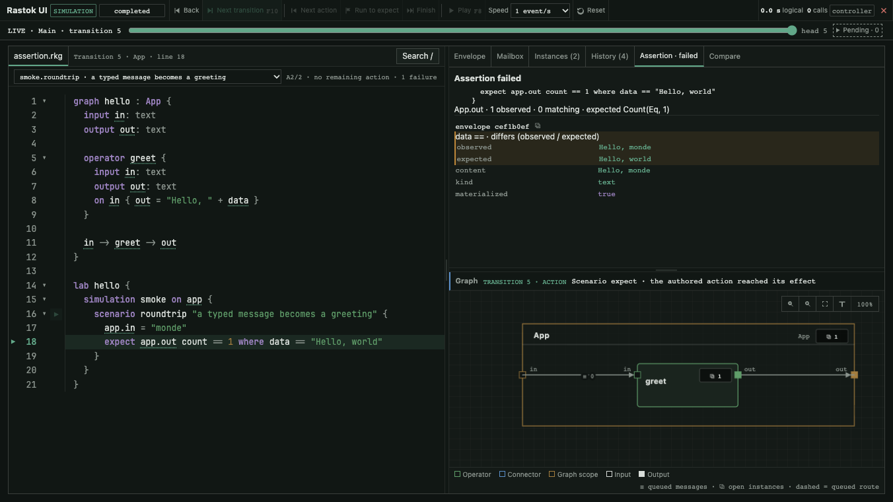

The debugger shows the program beside its recorded execution. Select a
transition to see the source, the graph and the inspector at the same point.
This tour uses the [webhook example](examples/04-webhook-to-partner.md): a
partner request times out, Retry schedules another attempt, and that attempt
succeeds.

## Open the debugger

Install a binary built with `hosted-ui`, then open a scenario:

```sh
rastok simulate hello.rkg --ui
```

Use the `hello.rkg` created in [Getting Started](getting-started.md), or supply
the path of your program. For an existing recording, use:

```sh
rastok replay echo.rkrec --ui
```

The CLI prints a loopback URL. Open that exact URL in your browser; it contains
the capability needed to access this debugger. Keep it private. The URL is
clickable in terminals that support hyperlinks. Leave the process running
while you inspect it. `--ui-port` selects a port when you need one; otherwise
the operating system chooses it.

Simulation starts paused and can execute its Lab scenario. Diagnostic replay
reads an existing recording without repeating external effects. These are
different modes of the same interface, not two names for the Play button.

## Find your way around

The numbered view is a recorded backoff transition of
`webhook.timeout_then_success`. The numbers were added to the running page
before capture; the state and values come from that scenario.



1. **App bar and mode.** The mode and execution status distinguish a live
   simulation, recorded history and diagnostic replay.
2. **Transport.** Back, Next transition, Next action, Run to expect, Finish,
   Play, Speed and Reset control which transition you see. The table below
   explains their differences.
3. **Timeline.** Select an already recorded transition or a simulation session.
   Return live goes back to the current execution head. Pending lists recorded
   obligations such as a retry deadline.
4. **Source.** File tabs, line numbers, the current marker and Search connect
   execution to the authored program. A selected graph element highlights its
   definition. Fold regions to keep the relevant part visible.
5. **Inspector.** Envelope shows data and metadata; Mailbox shows queued
   deliveries; Instances shows state and lifetime information; History shows
   recorded changes; Assertion explains an expectation; Compare aligns two
   instances or sessions for inspection.
6. **Graph and legend.** Nodes and connections show the selected transition.
   Select a node or a port to inspect it. The legend explains the visual
   notation; Fit and zoom change the view, not execution.
7. **Logical clock and controller.** The clock is the execution's logical
   time, not elapsed browser time. The controller role identifies the browser
   allowed to advance execution; another connected browser can inspect it.

## Advance deliberately

| Control | What it does |
|---|---|
| Back | Select the preceding recorded transition. |
| Next transition | Advance one recorded transition, executing when at the live head. |
| Next action | In simulation, advance one authored scenario action to its effect. |
| Run to expect | In simulation, continue to the next expectation. |
| Finish | Continue to completion. |
| Play / Pause | Advance through transitions at the selected playback speed, or stop. |
| Speed | Choose the playback rate; it does not change logical deadlines. |
| Reset | Start a clean simulation session for the selected scenario. |

Selecting history does not undo a real external effect. Play is a playback
control; `rastok replay` is the CLI command that opens a recording without
Driver I/O. Controls that do not apply in the current mode are unavailable.

## Follow an identifier

Hover an identifier in the source, or focus it with the keyboard, to read its
recorded summary. When available, its link opens the corresponding inspector
tab. Classified values and secret bindings stay redacted.



Selecting `greet` in the graph highlights its source definition. Source and
graph are two views of the same selected transition.



## Understand an assertion

In the starter, change only `app.in = "world"` to `app.in = "monde"`, leaving
the expectation unchanged. Open the changed program and choose Finish. The
Assertion tab shows the authored expectation, its observation window and the
observed value beside the expected value. Here the Operator produced
`"Hello, monde"`, not `"Hello, world"`.



An expectation inspects observations since the preceding injection or time
advance. Successive expectations can inspect the same window. The debugger
does not infer a missing observation or invent a comparison when a predicate
cannot be explained field by field.

## Keyboard shortcuts

| Key | Action |
|---|---|
| Left / Right | Select the preceding or following transition. |
| `n` or F10 | Next transition. |
| `a` | Next authored action. |
| Space or F8 | Play / Pause. |
| Enter | Open the selected envelope. |
| Escape | Dismiss an overlay or selection. |
| `/` | Search for a node, port or id. |

Tab moves between controls, source identifiers and graph elements. Inputs and
tab controls keep their own keys. Function keys work when the browser delivers
them to the page; Space and `n` provide alternatives.

## What you cannot edit here

This is not a development environment. It is read-only: values, source and
scenarios cannot be edited in the debugger in this version. Inputs come from
the scenario source, and there are no breakpoints. Edit the `.rkg` file in
your editor and restart the simulation to test a different program or input.

Continue with [the Lab](guide/04-the-lab.md),
[journal and replay](guide/05-running-for-real.md), or the
[command-line reference](guide/09-command-line.md).
