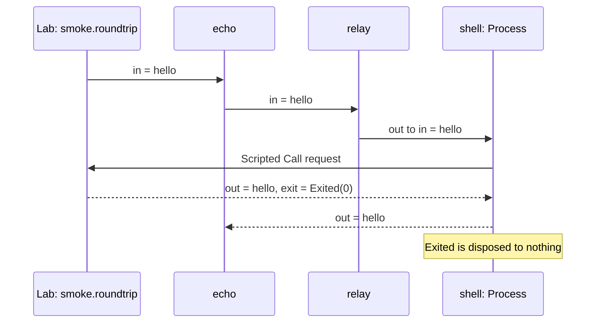

A line of text enters the program, and a real `cat` program, which repeats
what it reads, sends it back. The line leaves the App through its output.

There are two ways to run this program: the real world (App) starts `cat`;
the virtual world (Lab) supplies its responses from a mock. The graph stays
the same. You can test its success, filtering and timeout before starting
an external process.

The three [file formats](../guide/09-command-line.md#file-formats) have different
jobs: `.rkg` is the program and its Lab, `.trace` is a scenario's reference
trace, and `.rkrec` is a recording of a real execution.

## Run

From the repository root, with `rastok` installed:

```sh
rastok simulate examples/echo.rkg --compare examples/traces/echo
```

```text
PASS smoke.roundtrip: a line echoes back
PASS smoke.filtered: an empty line never reaches the shell
PASS smoke.silence_expires: a mute shell times out
3 scenario(s), 0 failed
```

This reads `examples/echo.rkg` and compares each scenario with its reviewed
file in `examples/traces/echo/`. The command starts no external process and
writes no reference trace.

## Read the program

Open `examples/echo.rkg` and read from top to bottom.

`graph echo : App` declares the application. It contains a Connector and
an Operator, with wiring between their ports.

The Connector `shell : Process` talks to an external program under the
[Process contract](../reference/connectors/process.md).
Here `mode = job` starts a child for each Call, `command = "cat"` selects the
program, and `codec = lines` exchanges lines of text. `timeout = duration("5s")`
bounds the wait. The declarations of idempotence and deterministic behavior
describe the repetition guarantee and the expected behavior of this command.

The Operator `relay` does not start a process. Its `on in where data != ""`
handler accepts a nonempty input and emits that data on `out`. An empty line
produces no output.

The wiring `in -> relay -> shell -> out` sends the App input to `relay`,
then to `shell`, then to the App output. The two remaining outputs,
`shell.err` and `shell.exit`, go to `nothing`: the program explicitly
discards them. They still exist in the journal and can be checked by the Lab.

Below the App, `lab echo` describes the virtual world. Its `simulation smoke
on app` groups scenarios for this App and provides their shared mock.

`mock shell` supplies the process response. In `on in { ... }`, `out = .`
means “emit the data this mock received”: the dot is the received data, so the
mock echoes it. `exit = Exited { exit_code = 0, signal = null }` then ends
the simulated process successfully. See [mock responses](../reference/lab.md#mock-responses)
for the other forms.

The scenarios are independent:

- `roundtrip` sends `"hello"`; `expect ... count == 1 where data == "hello"`
  requires exactly one matching App output, then `expect nothing shell.err`
  requires no error output.
- `filtered` sends `""`; `expect nothing shell.in` and `expect nothing app.out`
  check that the empty line reaches neither the process nor the App output.
- `silence_expires` replaces the shared mock with `out = nothing`, providing no
  terminal response; `advance duration("5s")` moves virtual time and the final
  expectation checks `TimeoutExpired` on `shell.exit`.

An [expectation](../reference/lab.md#expectations-and-windows) examines the
observations since the preceding input or time advance. It does not consume
them, so successive expectations can inspect the same window.

## Expected result

The roundtrip scenario follows this sequence, with the Lab supplying the
response instead of starting `cat`.



To run in the real world, use a macOS or Linux shell with `cat` on PATH.
The following command starts `cat` and writes `echo.rkrec` in your current
directory. A recording captures the real execution so it can be inspected
without starting that process again. Use an unused filename: existing
recordings are never overwritten.

```sh
printf 'hello\n' | rastok run examples/echo.rkg --record echo.rkrec
```

```text
hello
recorded: 8 causal records · seal 80f1263274f3b1b7480fdb13c007459e18e1e4cf10cc9bf08b5d12b63a4b7e0e
```

Echo has one App output, so stdout contains the value alone. The `recorded:`
summary goes to stderr. Now inspect the recording:

```sh
rastok replay echo.rkrec
```

```text
replay: 8 causal records · seal 80f1263274f3b1b7480fdb13c007459e18e1e4cf10cc9bf08b5d12b63a4b7e0e · completed recording · no Driver I/O
hello
```

Replay needs neither the original source nor `cat`. Its summary goes to
stderr; the output value goes to stdout. The matching seals describe the
same recorded execution, not a new call to the outside world.

A Lab execution and a real run do not have equal raw seals by default:
their input provenance differs, and real response timing can differ from
virtual time. Here the proof is equality between the real run and its
recorded replay.

## Break it

In `mock shell`, change exactly `out = .` to `out = "changed"`.
Leave the expected value `"hello"` unchanged. Run:

```sh
rastok simulate examples/echo.rkg --compare examples/traces/echo
```

```text
FAIL smoke.roundtrip: a line echoes back
     expect "the echo" app.out count == 1 where data == "hello"  (echo.rkg:35)
     observed app.out: "changed"
     where data == "hello" is false for 1 of 1 deliveries; count 0, expected 1
     golden divergence: record 6: closure(32)[1][0][1][1]; expected 82066568656c6c6f; got 8206676368616e67…(10 bytes); cause: EGRESS "shell" · emitting_id 801cfc175b8f2151…(16 bytes) · call_key absent
PASS smoke.filtered: an empty line never reaches the shell
PASS smoke.silence_expires: a mute shell times out
3 scenario(s), 1 failed
```

Restore the checked-in source:

```sh
git checkout -- examples/echo.rkg
```

That command discards your edits to this example. Then run the complete
comparison again:

```sh
rastok simulate examples/echo.rkg --compare examples/traces/echo
```

It prints the same three PASS lines and zero-failed total shown under Run.

## Read the golden difference

The expectation names the source line, the observed `"changed"` value and
the failed count. The golden difference names the first differing record,
its field, the expected and actual encoded values, and the Call that produced
it. Those are two checks: the assertion checks the authored expectation;
the trace comparison checks the reviewed causal history. Do not save a new
reference merely to make the comparison pass.

## Carry forward

For the concepts behind this example, read [A program](../guide/01-a-program.md)
and [The Lab](../guide/04-the-lab.md).

An injected fault belongs to the virtual world (Lab); the application stays
the same as in the real world (App). Keep that distinction when a partner
environment is not available yet.

Next: [File pipeline](02-file-pipeline.md). Replace the external program with
two file operations and ask what each effect is allowed to do.

## Limits

Reference traces contain causal evidence. Recordings are bounded local
diagnostics, not durable deployment journals or share-safe exports. The
recorder currently refuses personal-data plans and boot-dependent deployment
profiles. Diagnostic replay reconstructs recorded facts; it does not execute
a Lab scenario.
