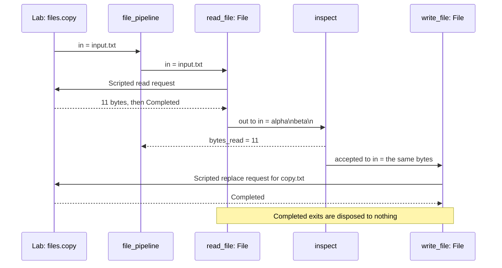

Echo separated computation from the world. Now the world contains files you
could overwrite. How do you make the permitted operation, its limits and its
refusals visible before the flow runs?

## Run

```sh
rastok simulate examples/file-pipeline.rkg --compare examples/traces/file-pipeline
```

For the controls and source view, see [the debugger tour](../debugger.md).

## Read the program

Find the two `File` Connectors: one reads, one replaces. Their modes describe
different operations under the same Contract. Between them, the Operator
decides whether the bytes should continue. Follow the `exit` routes too:
a refused read has a destination, rather than disappearing into a log.
The Lab replaces both file operations, using the same resolved port types.

## Expected result

In `files.copy`, both File Calls use Lab responses; the count is emitted
before the accepted bytes reach `write_file`.



The Lab supplies `alpha\nbeta\n`: eleven bytes. The Operator counts them and
forwards a nonempty value to the replacement File Connector. Empty input does
not overwrite the target. A directory produces `NotAFile`, routed to `failed`.
The `utf8` scenario counts `é\n` as three bytes, not two characters: the
reader's `bytes` port determines how the value is read.

To exercise real disk I/O, use a new temporary directory:

```sh
demo_root=$(mktemp -d)
printf 'alpha\nbeta\n' > "$demo_root/input.txt"
printf 'input.txt\n' | rastok run examples/file-pipeline.rkg --file-root "$demo_root" --record "$demo_root/copy.rkrec"
cmp "$demo_root/input.txt" "$demo_root/copy.txt"
printf 'changed after recording\n' > "$demo_root/input.txt"
rastok replay "$demo_root/copy.rkrec"
```

Replay prints the same recorded output and seal without reading or replacing
either file. It does not restore the disk to its earlier contents. Use
`replay "$demo_root/copy.rkrec" --ui` to inspect the recorded history.

## Break it

Change `size(data) > 0` to `size(data) > 20`. The eleven-byte example is now
rejected and the writer receives nothing. Rerun without `--save`.

## Read the golden difference

The first changed Operator transaction names its changed emission and causal
input. The `bytes_read` and writer assertions also fail. Restore the threshold
and verify that the original golden matches again.

## Carry forward

The guide explains the same source in [Types and expressions](../guide/02-types-and-expressions.md)
and [Connectors and outcomes](../guide/03-connectors-and-outcomes.md).

The Contract makes an effect reviewable: input, operation, bounds and outcomes
travel together. Your application decides what to do with each result. A
recording then lets you inspect what happened without repeating those effects.

Previous: [Echo](01-echo.md). Next: [Two tenants](03-two-tenants.md), where the
new question is who owns the state when several requests share a graph.

## Limits

`max_read` bounds the complete input: no partial bytes are published on a read
refusal. `File` does not implement recursive directory operations, append or
watch. Atomic replacement concerns one target and depends on the Driver's
supported filesystem boundary; refusals have typed outcomes.
The `directory` Lab scenario scripts that result; the real File tests qualify
the actual filesystem refusal. The example validates and copies bytes.
