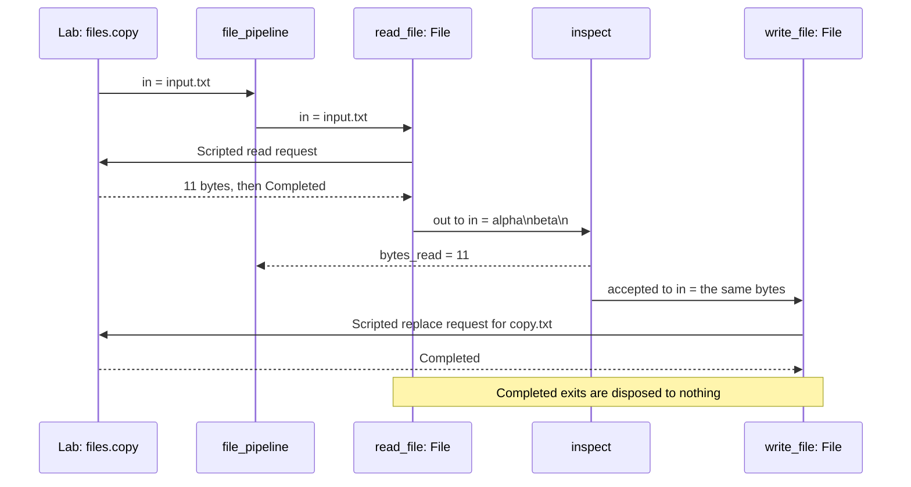

This program reads a file, counts its bytes and copies nonempty content to another file.

Echo separated computation from the world. Now the world contains files you
could overwrite. How do you make the permitted operation, its limits and its
refusals visible before the flow runs?

The [file formats](../guide/09-command-line.md#file-formats) are `.rkg` for
the program and Lab, `.rkc` for a reviewed scenario reference and `.rkr`
for a real execution recording.

## Run

From the repository root, with `rastok` installed:

```sh
rastok simulate examples/file-pipeline.rkg --compare examples/traces/file-pipeline
```

```text
PASS files.copy
PASS files.empty
PASS files.utf8
PASS files.directory
PASS files.single_byte
5 scenario(s), 0 failed
```

For the controls and source view, see [the debugger tour](../debugger.md).

## Read the program

Find the two [File](../reference/connectors/file.md) Connectors: one reads, one replaces. Their modes describe
different operations under the same Contract. Between them, the Operator
decides whether the bytes should continue. Follow the `exit` routes too:
a refused read has a destination, rather than disappearing into a log.
The Lab replaces both file operations, using the same resolved port types.

In a port declaration, the name after `:` is its payload's type: the values
it may accept or emit. `output failed: FileExit` declares an output port
named `failed`, not a new type. See the [type reference](../reference/types.md)
for the notation. `FileExit` comes from the [standard library](../reference/stdlib.md#types),
without an import or copied declaration; its cases are the ones on File's
`exit` port.

The [Lab reference](../reference/lab.md) explains mock responses, expectations
and observation windows. `advance` supplies virtual time; a mock's terminal
response ends its simulated exchange, not the whole scenario.

## Expected result

In `files.copy`, both File Calls use Lab responses; the count is emitted
before the accepted bytes reach `write_file`.



The Lab supplies `alpha\nbeta\n`: eleven bytes. The Operator counts them and
forwards a nonempty value to the replacement File Connector. Empty input does
not overwrite the target. A directory produces `NotAFile`, routed to `failed`.
The `utf8` scenario counts `é\n` as three bytes, not two characters: the
reader's `bytes` port determines how the value is read. `single_byte` supplies
`x`, exactly one byte, and checks that it reaches the writer rather than the
`empty` output. This is the smallest input accepted by `size(data) > 0`.

To exercise real disk I/O, use a macOS or Linux shell with `mktemp`, `printf`
and `cmp` on PATH. This creates a new temporary directory; both file operations
are confined to that directory, and the recording uses an unused path:

```sh
demo_root=$(mktemp -d)
printf 'alpha\nbeta\n' > "$demo_root/input.txt"
printf 'input.txt\n' | rastok run examples/file-pipeline.rkg --file-root "$demo_root" --record "$demo_root/copy.rkr"
cmp "$demo_root/input.txt" "$demo_root/copy.txt"
printf 'changed after recording\n' > "$demo_root/input.txt"
rastok replay "$demo_root/copy.rkr"
```

The run printed:

```text
bytes_read: Materialized(Int(11))
recorded: 12 causal records · seal bfa1df6bc5ab7eaeb42419aa0203af9b5350ee0e4252f96ed4fcb2c4159f7977
```

`cmp` exited successfully without output. After changing the input file,
replay printed:

```text
replay: 12 causal records · seal bfa1df6bc5ab7eaeb42419aa0203af9b5350ee0e4252f96ed4fcb2c4159f7977 · completed recording · no Driver I/O
bytes_read: Materialized(Int(11))
```

Replay prints the same recorded output and seal without reading or replacing
either file. It does not restore the disk to its earlier contents. Use
`rastok replay "$demo_root/copy.rkr" --ui` to inspect the recorded history.

## Break it

Change `size(data) > 0` to `size(data) > 1`. The one-byte input is now
rejected as empty, but the other four scenarios still pass. Run the comparison:

```sh
rastok simulate examples/file-pipeline.rkg --compare examples/traces/file-pipeline
```

```text
PASS files.copy
PASS files.empty
PASS files.utf8
PASS files.directory
FAIL files.single_byte
     expect app.bytes_read == 1  (file-pipeline.rkg:76)
     nothing observed
     expected 1 matching delivery on app.bytes_read, but observed 0
     expect write_file.in where size(data) == 1  (file-pipeline.rkg:77)
     nothing observed
     where size(data) == 1 is false for 0 of 0 deliveries; count 0, expected 1
     expect app.empty == nothing  (file-pipeline.rkg:78)
     observed app.empty: true
     expected no deliveries on app.empty, but observed 1
     golden divergence: record 7: emissions(23)[0][0]; expected "bytes_read"; got "empty"; cause: TRANSACTION "inspect" · trigger "p:in" · cause_id absent
5 scenario(s), 1 failed
```

Restore the checked-in source (this discards your edits to this example):

```sh
git checkout -- examples/file-pipeline.rkg
```

## Read the golden difference

The first changed Operator transaction names its changed emission and causal
input. In `single_byte`, the byte count and writer assertions fail, and the
`empty` output appears where the scenario expects none. The assertions fail
even without `--compare`; the golden also locates the first changed record.

A passing scenario tests the inputs and responses it supplies, not every
possible value. The earlier empty, three-byte and eleven-byte cases could
not distinguish `> 0` from `> 1`. The one-byte case adds that boundary to the
reviewed examples. A golden comparison does not prove two programs equivalent
for inputs absent from the Lab. Restore the threshold and compare again.

## Carry forward

The guide explains the same source in [Types and expressions](../guide/02-types-and-expressions.md)
and [Connectors and outcomes](../guide/03-connectors-and-outcomes.md).

The Contract makes an effect reviewable: input, operation, bounds and outcomes
travel together. Your application decides what to do with each result. A
recording then lets you inspect what happened without repeating those effects.

Previous: [Echo](01-echo.md). Next: [Two tenants](03-two-tenants.md), where the
new question is who owns the state when several requests share a graph.

## Limits

`max_read` bounds the complete input: no partial bytes are published on a read
refusal. `File` does not implement recursive directory operations, append or
watch. Atomic replacement concerns one target and depends on the Driver's
supported filesystem boundary; refusals have typed outcomes.
The `directory` Lab scenario scripts that result; the real File tests qualify
the actual filesystem refusal. The example validates and copies bytes.
