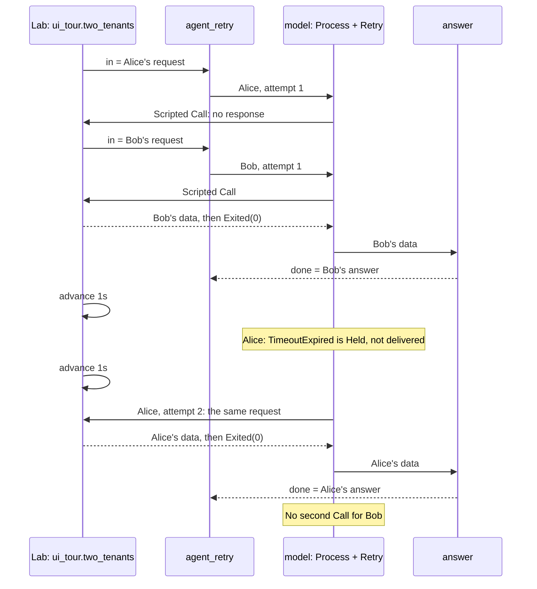

A file pipeline is easy to follow one request at a time. What happens when
Alice's partner stalls while Bob's request is ready? This chapter adds
instance ownership and finite retry to the same graph-and-Lab model.

The versioned goldens cover native Retry: the failed attempt remains visible
in the journal, while only the final outcome reaches the graph.

## Run

```sh
rastok simulate examples/keyed-retry.rkg --compare examples/traces/two-tenants
```

Add `--ui` to follow the same checked scenario in the debugger.

## Read the graph

Start with `instance = { key = data.tenant }`: it selects independent state
for Alice and Bob. `Retry.attempts = 2` bounds Calls for one retained request,
including the first; `lifetime` bounds how long an idle instance lives. They
solve different problems.
Then read `model : Process + Retry`: `Retry.on = [TimeoutExpired]` selects
the terminal that permits another attempt. Retry retains the original request
across attempts. `answer` decodes the final Process frame after the Retry
manager has selected it. The nested `audit` Graph composes another branch.

## Expected result

This cut of `ui_tour.two_tenants` follows `model` and `answer`; the separate
`audit.observe` branch runs once per input and is omitted here.



Alice enters first and waits. Bob enters a separate instance and finishes
immediately. Advancing one second expires Alice's Call;
the next second admits her retry, which finishes. Bob
receives no second Call. The `lifetime` scenario advances through ten seconds
of silence, then proves that a new admission uses a fresh instance generation.

`⧉` counts instances. The Instances tab's Retry table shows Bob's one attempt
and Alice's two distinct Calls. Alice's timeout is recorded as **Held**, not
delivered to the `failed` output; the final attempt is **Published**. The audit
runs once per incoming request, not again for an internal retry.

## Break it

Change `Retry.attempts = 2` to `Retry.attempts = 1`. Alice can no longer be
readmitted: her original `TimeoutExpired` reaches `failed`, and the assertion
expecting Alice's answer fails. Bob still finishes once. There is no new
`RetryExpired` error type.

## Read the golden difference

Add `--compare examples/traces/two-tenants` to compare every
record. The unedited example matches. After your edit, the CLI names the first
difference and recorded context, which can precede the final missing answer.
Restore the attempt bound afterward.

## Carry forward

Ask two separate questions in every stateful flow: "whose state?" and "for
how long?" A key answers the first, a lifetime the second. Neither alone
means that a duplicate request will be ignored. The next chapter will make
that policy an explicit piece of state.

Previous: [File pipeline](02-file-pipeline.md). Next:
[Webhook to partner](04-webhook-to-partner.md), combining these mechanisms
into an integration you can qualify before its partner is ready.

## Limits

The Process mock is stateless: the admitted request and explicit logical time
select its reply. Only Alice's request at time zero is silent.
No real language model or paid API is used. The instance key isolates state but
does not guarantee deduplication or persistence across a deployment restart.
The fixed backoff is one second.
