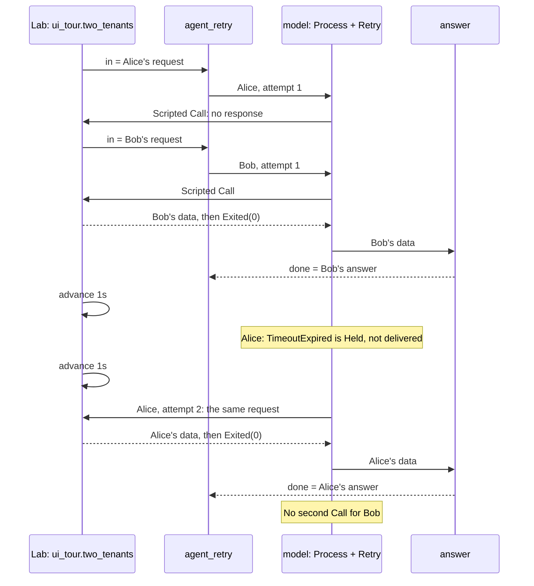

This program handles requests from two tenants independently, repeating Alice's timed-out request while Bob's completes.

A file pipeline is easy to follow one request at a time. What happens when
Alice's partner stalls while Bob's request is ready? This chapter adds
instance ownership and finite retry to the same graph-and-Lab model.

The versioned goldens cover native Retry: the failed attempt remains visible
in the journal, while only the final outcome reaches the graph.

The [file formats](../guide/09-command-line.md#file-formats) are `.rkg` for
the program and Lab, `.rkc` for a reviewed scenario reference and `.rkr`
for a real execution recording.

## Run

From the repository root, with `rastok` installed:

```sh
rastok simulate examples/keyed-retry.rkg --compare examples/traces/two-tenants
```

```text
PASS ui_tour.two_tenants
PASS ui_tour.lifetime
2 scenario(s), 0 failed
```

Add `--ui` to follow the same checked scenario in the debugger.

```sh
rastok simulate examples/keyed-retry.rkg --compare examples/traces/two-tenants --ui
```

This requires `hosted-ui`. Open the private loopback URL printed by the CLI.

For the controls and source view, see [the debugger tour](../debugger.md).

## Read the program

The file starts with `type Request = struct { ... }`. This names a payload
shape with two text fields, `tenant` and `prompt`; it does not create a
request. `input in: Request` then uses that type on a port. The
[type reference](../reference/types.md) explains structs and other type forms.

Start with `instance = { key = data.tenant }`: it selects independent state
for Alice and Bob. `Retry.attempts = 2` bounds Calls for one retained request,
including the first; `lifetime` bounds how long an idle instance lives. They
solve different problems.

An instance is not a thread or a process. The current runtime executes
Operator transactions one at a time, but an outstanding external Call does
not prevent another instance from progressing. Bob can finish while Alice
waits; this does not demonstrate parallel Operator execution. See
[Instances, state and time](../guide/06-instances-state-and-time.md) for
ownership and lifetime, and [Execution and concurrency](../reference/execution.md)
for the current runtime and the planned worker pool.

Then read `model : Process + Retry`, using the [Process contract](../reference/connectors/process.md): `Retry.on = [TimeoutExpired]` selects
the terminal that permits another attempt. Retry retains the original request
across attempts. `answer` decodes the final Process frame after the Retry
manager has selected it. The nested `audit` Graph composes another branch.

The [Lab reference](../reference/lab.md) explains mock responses, expectations
and observation windows. `advance` supplies virtual time; a mock's terminal
response ends its simulated exchange, not the whole scenario.

## Expected result

This cut of `ui_tour.two_tenants` follows `model` and `answer`; the separate
`audit.observe` branch runs once per input and is omitted here.



Alice enters first and waits. Bob enters a separate instance and finishes
immediately. Advancing one second expires Alice's Call;
the next second admits her retry, which finishes. Bob
receives no second Call. The `lifetime` scenario advances through ten seconds
of silence, then proves that a new admission uses a fresh instance generation.

`⧉` counts instances. The Instances tab's Retry table shows Bob's one attempt
and Alice's two distinct Calls. Alice's timeout is recorded as **Held**, not
delivered to the `failed` output; the final attempt is **Published**. The audit
runs once per incoming request, not again for an internal retry.

## Break it

Change `Retry.attempts = 2` to `Retry.attempts = 1`. Alice can no longer be
readmitted: her original `TimeoutExpired` reaches `failed`, and the assertion
expecting Alice's answer fails. Bob still finishes once. There is no new
`RetryExpired` error type.

```sh
rastok simulate examples/keyed-retry.rkg --compare examples/traces/two-tenants
```

```text
FAIL ui_tour.two_tenants
     expect app.done where data.tenant == "alice"  (keyed-retry.rkg:91)
     nothing observed
     where data.tenant == "alice" is false for 0 of 0 deliveries; count 0, expected 1
     expect answer.in where data is Answer && data.tenant == "alice"  (keyed-retry.rkg:92)
     nothing observed
     where data is Answer && data.tenant == "alice" is false for 0 of 0 deliveries; count 0, expected 1
     golden divergence: record 6: retry_protocol(43) . parent_id(2)[0][4]; expected e0091a67cd4992a8…(32 bytes); got 8783e6cca4a7d30f…(32 bytes); cause: TRANSACTION "model" · trigger "l:retry" · cause_id f3df1105112054d3…(16 bytes)
FAIL ui_tour.lifetime
     golden divergence: record 6: retry_protocol(43) . parent_id(2)[0][4]; expected e0091a67cd4992a8…(32 bytes); got 8783e6cca4a7d30f…(32 bytes); cause: TRANSACTION "model" · trigger "l:retry" · cause_id f3df1105112054d3…(16 bytes)
2 scenario(s), 2 failed
```

Restore the checked-in source (this discards your edits to this example):

```sh
git checkout -- examples/keyed-retry.rkg
```

## Read the golden difference

Add `--compare examples/traces/two-tenants` to compare every
record. The unedited example matches. After your edit, the CLI names the first
difference and recorded context, which can precede the final missing answer.
Restore the attempt bound afterward.

## Carry forward

Ask two separate questions in every stateful flow: "whose state?" and "for
how long?" A key answers the first, a lifetime the second. Neither alone
means that a duplicate request will be ignored. The next chapter will make
that policy an explicit piece of state.

Previous: [File pipeline](02-file-pipeline.md). Next:
[Webhook to partner](04-webhook-to-partner.md), combining these mechanisms
into an integration you can qualify before its partner is ready.

## Limits

The Process mock is stateless: the admitted request and explicit logical time
select its reply. Only Alice's request at time zero is silent.
No real language model or paid API is used. The instance key isolates state but
does not guarantee deduplication or persistence across a deployment restart.
The fixed backoff is one second.
