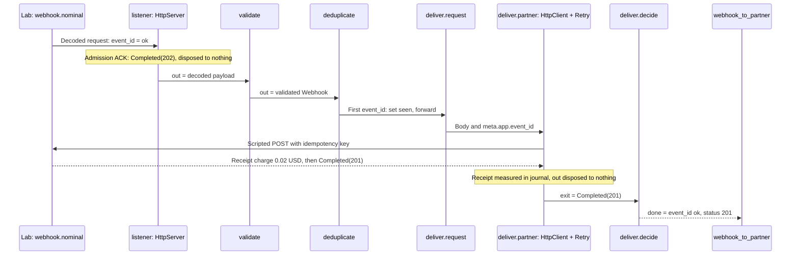
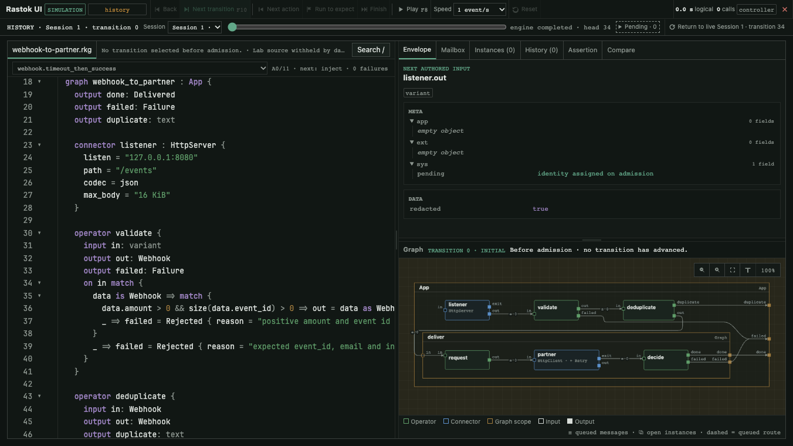

This program accepts a webhook, rejects invalid or duplicate events and sends accepted events to a partner.

You know how to replace an effect, route its outcomes and isolate state. Now
use those ideas for a familiar integration: receive a webhook and deliver it
to a partner that is not always available. Build the flow and its fault
scenarios together, before you need a live partner environment.

All six scenarios have versioned goldens. The captures below show native
Retry retaining a failed attempt and publishing the final outcome.

The [file formats](../guide/09-command-line.md#file-formats) are `.rkg` for
the program and Lab, `.trace` for a reviewed scenario reference and `.rkrec`
for a real execution recording.

## Run

From the repository root:

```sh
env RASTOK_SHOWCASE_PARTNER_TOKEN=lab-only-not-a-credential \
    RASTOK_SHOWCASE_PARTNER_TOKEN_VERSION=fixture-v1 \
    rastok simulate examples/webhook-to-partner.rkg \
      --deployment examples/webhook-to-partner.deployment.json \
      --compare examples/traces/webhook-to-partner
```

```text
PASS webhook.nominal: ACK, validate, deliver once
PASS webhook.timeout_then_success: the same request is repeated; only the final result is published
PASS webhook.partner_dead: two attempts, then the last failure unchanged
PASS webhook.duplicate: explicit state suppresses a duplicate, not instance identity alone
PASS webhook.invalid_payload: decoded but ill-typed or invalid business data is rejected after ACK
PASS webhook.http_500: Retry selects the decoded ServerError and retains its charge
6 scenario(s), 0 failed
```

Add `--ui` to inspect the same graph.

```sh
env RASTOK_SHOWCASE_PARTNER_TOKEN=lab-only-not-a-credential RASTOK_SHOWCASE_PARTNER_TOKEN_VERSION=fixture-v1 rastok simulate examples/webhook-to-partner.rkg --deployment examples/webhook-to-partner.deployment.json --compare examples/traces/webhook-to-partner --ui
```

This requires `hosted-ui`. Open the private loopback URL printed by the CLI. No HTTP listener, real partner or paid
API is started. The value above is a **fictional fixture**, not a credential.
For real deployments, supply secret material out of band, never in source,
profile JSON or shell command text. The profile contains only its coordinate
and version. The same Contract is used with a scripted or physical Driver.

For the controls and source view, see [the debugger tour](../debugger.md).

## Read the program

Follow the main path first: `listener`, an [HttpServer](../reference/connectors/http-server.md), admits, `validate` checks the business
data, `deduplicate` owns a `seen` flag per event, and `deliver` contains the
bounded partner retry. Open that scope to find `request`,
`partner : HttpClient + Retry` ([HttpClient](../reference/connectors/http-client.md)) and `decide`. The response type `Receipt`
annotates the charge where the Connector retains it, before any decision to
hold or publish the attempt.
`decide` classifies the final business outcome; it contains no retry logic.

Then read the declarations that constrain the path: the idle lifetime, the
partner's idempotency key, the exhaustive destinations, `@personal` and the
secret reference. These are reviewable parts of the program and deployment,
not separate conventions the reader must guess from the happy path.

The [Lab reference](../reference/lab.md) explains mock responses, expectations
and observation windows. `advance` supplies virtual time; a mock's terminal
response ends its simulated exchange, not the whole scenario.

## Expected result

In `webhook.nominal`, admission produces the ACK before business validation;
the scripted partner then completes the first attempt.



`6 scenario(s), 0 failed` covers:

- `nominal`: one `202` ACK and one partner Call ending with `201`;
- `timeout_then_success`: one second to timeout, one second of backoff,
  then success on the second attempt;
- `partner_dead`: two timed-out Calls, then the final `TimeoutExpired`
  inside the business `PartnerFailed` response, with
  no further Call even after another ten seconds;
- `duplicate`: an explicit `seen` state suppresses a second request with
  the same event id; after five minutes idle, a fresh instance admits it again;
- `invalid_payload`: decoded JSON with the wrong shape, then a negative
  amount, both rejected after ACK and without contacting the partner;
- `http_500`: `ServerError { status: 500 }` is a decoded response; the
  static `Retry.on` policy selects it, and the second response is `201`.

The email field is `@personal`. The deployment must attest the in-memory
processing before admission; having a valid secret binding alone is not
enough. Debugger views redact before formatting. Personal data can remain in
the in-memory causal journal: presentation masking is not erasure. The bearer
is different: its clear bytes never enter the journal at all.

The declared `output out: Receipt` interprets the fictional partner's `charge`
field as an exact amount with `@measure(id = amount, unit = "USD")`.
That declaration names a quantity and its unit, not a billing policy. No downstream accounting
Operator is run or replayed to extract it. The nominal reply reports
`0.02`; the `500` and successful replies retain two separate samples, `0.01`
and `0.02`, with their causal references. The first is Held by Retry and
never reaches `decide`; it remains inspectable in the journal. M1 computes no
total or price and the debugger displays the original DATA, not a cost report. A timed-out Call
supplies no charge: missing evidence is **unknown cost, not a zero bill**.

## Break it

Change the single `Retry.attempts = 2` to `Retry.attempts = 1`. The timeout and
`500` scenarios can no longer succeed on a second attempt. Run the comparison below.

```sh
env RASTOK_SHOWCASE_PARTNER_TOKEN=lab-only-not-a-credential RASTOK_SHOWCASE_PARTNER_TOKEN_VERSION=fixture-v1 rastok simulate examples/webhook-to-partner.rkg --deployment examples/webhook-to-partner.deployment.json --compare examples/traces/webhook-to-partner
```

```text
FAIL webhook.nominal: ACK, validate, deliver once
     golden divergence: record 12: retry_protocol(43) . parent_id(2)[0][4]; expected [REDACTED]; got [REDACTED]; cause: [REDACTED]
FAIL webhook.timeout_then_success: the same request is repeated; only the final result is published
     expect [REDACTED]  (webhook-to-partner.rkg:174)
     observed: [REDACTED]
     Assertion evidence is redacted because this program carries classified data.
     expect [REDACTED]  (webhook-to-partner.rkg:176)
     observed: [REDACTED]
     Assertion evidence is redacted because this program carries classified data.
     expect [REDACTED]  (webhook-to-partner.rkg:177)
     observed: [REDACTED]
     Assertion evidence is redacted because this program carries classified data.
     golden divergence: record 12: retry_protocol(43) . parent_id(2)[0][4]; expected [REDACTED]; got [REDACTED]; cause: [REDACTED]
FAIL webhook.partner_dead: two attempts, then the last failure unchanged
     expect [REDACTED]  (webhook-to-partner.rkg:186)
     observed: [REDACTED]
     Assertion evidence is redacted because this program carries classified data.
     golden divergence: record 12: retry_protocol(43) . parent_id(2)[0][4]; expected [REDACTED]; got [REDACTED]; cause: [REDACTED]
FAIL webhook.duplicate: explicit state suppresses a duplicate, not instance identity alone
     golden divergence: record 12: retry_protocol(43) . parent_id(2)[0][4]; expected [REDACTED]; got [REDACTED]; cause: [REDACTED]
PASS webhook.invalid_payload: decoded but ill-typed or invalid business data is rejected after ACK
FAIL webhook.http_500: Retry selects the decoded ServerError and retains its charge
     expect [REDACTED]  (webhook-to-partner.rkg:222)
     observed: [REDACTED]
     Assertion evidence is redacted because this program carries classified data.
     expect [REDACTED]  (webhook-to-partner.rkg:225)
     observed: [REDACTED]
     Assertion evidence is redacted because this program carries classified data.
     golden divergence: record 12: retry_protocol(43) . parent_id(2)[0][4]; expected [REDACTED]; got [REDACTED]; cause: [REDACTED]
6 scenario(s), 5 failed
```

Restore the checked-in source (this discards your edits to this example):

```sh
git checkout -- examples/webhook-to-partner.rkg
```

## Read the golden difference

Add
`--compare examples/traces/webhook-to-partner`.
The CLI names the first differing record and field, expected versus actual,
and recorded causal context. This classified graph deliberately redacts
values in divergence messages. Recorded operation facts can differ before
the final answer does.
The versioned goldens contain **only the synthetic fixture data**; they are
not sanitised exports suitable for real personal data.

The following 30-second sequence visits recorded states of
`webhook.timeout_then_success`: admission, timeout, backoff and successful
second attempt. During the backoff, Retry retains the failed batch without
delivering it to `decide`; only the final result is published. These are real
debugger views of a simulation, not live HTTP requests or an edited branch.



Three stills make the checkpoints easier to inspect:

- [Before admission, transition 0](../assets/webhook-before.png).
- [Retry backoff scheduled, transition 20](../assets/webhook-backoff.png).
- [Success after two attempts, transition 34](../assets/webhook-completed.png).

## Carry forward

Read [Connectors and outcomes](../guide/03-connectors-and-outcomes.md) for the
admission boundary and [Running for real](../guide/05-running-for-real.md)
for deployment settings, secrets and diagnostic evidence.

This is the central exercise: one integration, several possible worlds, and
a recorded explanation when a revision changes behavior. Keep the timeout,
duplicate and 500 scenarios alongside the nominal one. Each describes a case
the next change must still handle; passing them is evidence under their stated
world assumptions, not proof that every real partner will behave that way.

Previous: [Two tenants](03-two-tenants.md). Next:
[Sensor alarm](05-sensor-alarm.md). The same approach can test an event that
never arrives, without making the test wait in real time.

## Limits

Malformed JSON, failed authentication and an excessive wire body are refused
before a root or ACK exists. A decoded Lab injection cannot exercise that
decoder. The separate physical loopback proof is:

```sh
cargo test -p rastok --lib --features hosted-http12 auth_codec_and_body_refusals_never_invent_an_inbound_call
```

The filtered test result was:

```text
test connector::drivers::network::http_server::tests::auth_codec_and_body_refusals_never_invent_an_inbound_call ... ok
```

An instance key isolates state; `seen` does the deduplication. This is
accept-once within an **idle** retention window: duplicates extend that
window, and a permanently failed job is still considered seen until expiry.
It is not exactly-once delivery, a durable outbox, or automatic resubmission
after failure. A restart loses that state. The partner must honour the stable
idempotency key, upsert by `event_id`; the request and key remain identical
between attempts. Both retry paths rely on that external property. The example
does not test a real partner's idempotence.

The supplied privacy profile describes a local synthetic demonstration, not
legal authority for production processing. Real purposes, recipients,
transfers and retention require deployment-specific review. No persistent
personal-data journal or `run --record` is admitted by this example. Kafka
and SQL are not shown. Modify the scenario on disk to try another world;
there is no debugger branch or payload editor.
