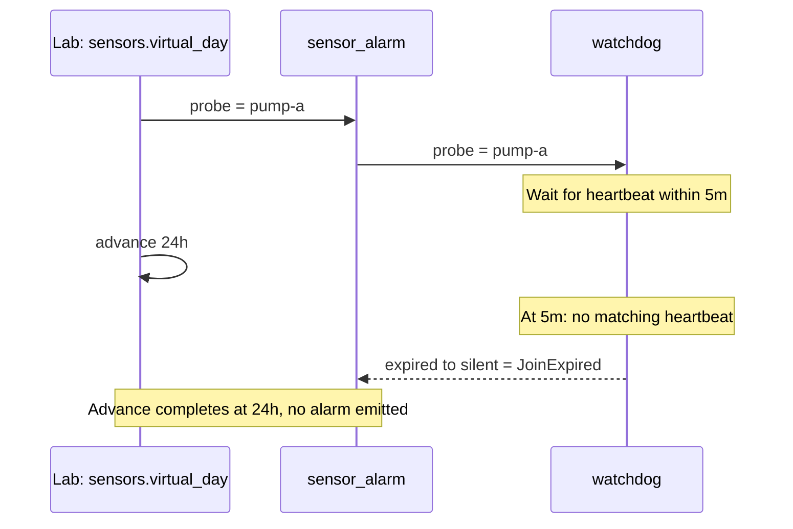

The partner example tested a response and a timeout. Now ask a harder
question: how do you test silence? Keep state per sensor, distinguish a
threshold crossing from noise, and make the waiting period an explicit input
to your scenario.

## Run

```sh
rastok simulate examples/sensor-alarm.rkg --compare examples/traces/sensor-alarm
```

## Read the graph

First follow the readings into the keyed stateful Operator: its two thresholds
prevent an alarm from oscillating around one limit. Then find the `watchdog`
join. A probe and heartbeat rendezvous within a bounded interval; a missing
partner produces `JoinExpired`, whose route is as explicit as a normal output.
Read `advance` in the Lab last: time comes from the scenario, not from sleeps
hidden in the application.

## Expected result

The golden's `sensors.virtual_day` follows one unanswered probe, not the
separate hysteresis scenario; the advance visits its five-minute deadline.



Pump-a trips above 120, stays tripped at 100, and clears below 80. Pump-b has
independent state. A keyed join pairs a probe with a heartbeat within five
minutes; only the unanswered probe expires in the silent-sensor scenario.
The final scenario advances twenty-four virtual hours in one authored action.

On the local macOS arm64 reference host, three warm invocations of the debug
CLI running **all three scenarios** took **12.118 ms, 8.899 ms and 7.616 ms**.
Compilation and golden comparison were excluded. These are measured process
wall times, not a promise about another machine or a production workload.
A prior cold invocation took 10.94 s; neither number changes logical time.
Reproduce the warm measurement with an external monotonic timer:

```sh
ruby -e '3.times { t = Process.clock_gettime(Process::CLOCK_MONOTONIC); ok = system(*ARGV); puts format("elapsed_cli_seconds=%.6f", Process.clock_gettime(Process::CLOCK_MONOTONIC) - t); exit 1 unless ok }' target/debug/rastok simulate examples/sensor-alarm.rkg
```

## Break it

Raise the trip threshold from 120 to 130. The sample at 121 no longer trips,
and the original assertion and golden fail. Alternatively, remove the route
from `watchdog.expired`: the checker refuses `E-UNWIRED-OUTPUT` before execution.

## Read the golden difference

The threshold edit changes a recorded Operator transaction, including its
state delta and emitted alarm. The diff gives the first changed record,
expected/actual values and causal trigger. The missing expiry route is a
static error, not a runtime golden difference.

## Carry forward

[The Lab](../guide/04-the-lab.md) explains this example's virtual clock and
the observation window used by its expectations.

Time, like an external response, is something you can supply deliberately.
You can retain a missed heartbeat as a small regression scenario instead of
waiting for the fault to recur on equipment. Types, state ownership and the
same causal comparison still apply; the device domain needs no special Lab.

The core evaluating this graph has no clock, network access or randomness;
time and external outcomes enter as explicit inputs. CI compiles `rastok-core`
for targets without an operating system: `thumbv8m.main-none-eabihf`,
`thumbv7m-none-eabi` and `riscv32imac-unknown-none-elf`. It also runs the
RP2350 spike under QEMU's Cortex-M33 emulation. Running this sensor example
on a physical board is not part of the alpha.

Previous: [Webhook to partner](04-webhook-to-partner.md).
Next: [Agent gateway](06-agent-gateway.md): keep a separate resident process
for each conversation and interleave several turns. Before moving on, try
writing a second silent-sensor scenario and explaining its first expiry from
the journal.

## Limits

This is a requested probe/heartbeat rendezvous, not automatic periodic polling.
No sensor protocol, process or paid model runs. An unmatched value on either
join input can produce `JoinExpired`; the scenarios explicitly control which
side is silent. Expiry DATA has no sensor field: its keyed instance and causal
history supply that context. The benchmark tasks informed the example, but
no claim is made that a published model wave authored it.
