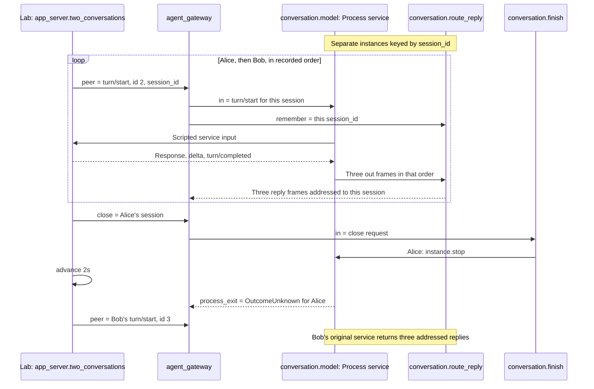

The sensor chapter kept state while time passed. A conversation adds state
outside the graph: the memory of a child process. Alice and Bob should each
keep their own child across several turns. Ending Alice's child must not
interrupt Bob, and sending a message must not be mistaken for receiving an
answer.

## Run

```sh
rastok simulate examples/agent-gateway.rkg --compare examples/traces/agent-gateway --ui
```

The debugger starts paused in the source view. Follow one input with
**Next transition** and watch the source marker. Hover a port identifier, or
focus it with Tab, to inspect its recorded value and open the full object in
the inspector. The instance and Session tables show the recorded ownership.
The **Graph** pane below the inspector follows connections while the source
stays visible on the left. Selecting a node selects its source definition and
inspector context. Both dividers are adjustable. **Fit graph** shows the complete
drawing; **Readable size** restores interface-sized text with panning. Instance
sections show counts and keep empty sections folded. For the reproducible CLI check:

```sh
rastok simulate examples/agent-gateway.rkg --compare examples/traces/agent-gateway
```

For the controls and source view, see [the debugger tour](../debugger.md).

## Read the program

Start at `clients.out`: each WebSocket message enters `conversation`, where
`instance = { key = meta.ext.session_id }` scopes its children. The first
message opens `Process(mode = service)`; later messages write to the same
child. Each `route_reply` instance remembers its socket address and restores
it on that child's responses.

The real command is `codex app-server --listen stdio://`. The client, not
Process, speaks its JSON-RPC protocol: initialize, acknowledge initialization,
start a thread, send a turn. Requests, replies and notifications pass through
as JSON, including client replies without a `method` field. The Lab's `match`
replaces the child; it never launches Codex. Its `peer` input supplies the
scenario's incoming messages.

Follow `finish.out -> model.instance.stop` last. An authored `close` input
requests that exact child generation's Closing, not every Process or the
whole conversation Graph. Socket closure has its own `session_exit` output.

## Expected result

This cut of `app_server.two_conversations` starts after both initialization
and thread exchanges. The Lab enters through `peer`, not a real socket;
each reply also targets `clients.in`, omitted here to focus on isolation.



Alice and Bob both initialize and start a thread. Both use request ids 0, 1
and 2: isolation cannot rely on globally unique RPC ids. Each scripted turn
returns an initial response, a text delta and a final notification. Two
resources serve the conversation, not one process per message. Alice's stop
settles as `OutcomeUnknown` because the mock supplies no system-shutdown
observation. Bob's next turn still uses his original child.

The second scenario returns a scripted unknown-method error. It is JSON data,
not a Process `exit`. The separate resident primer,
[agent-dialogue.rkg](../../../examples/agent-dialogue.rkg), shows an
application `quit`, observed resource exit and a fresh resource on new input.

## Add the small browser client

The next step is [Rastok Codex Gateway](../../../examples/agent-chat.rkg), with a
single [readable HTML file](../../../examples/agent-chat.html). It uses plain
HTML, CSS and JavaScript, with English comments: no framework, build step,
CDN or generated bundle. Start with its scripted protocol:

```sh
rastok simulate examples/agent-chat.rkg
```

Three scenarios cover interleaved conversations, a duplicate nickname and
invalid messages. The same app-server handshake is now wrapped in
`{ nickname, kind, rpc }`. `conversation` is keyed by the nickname and remembers
its socket; a second socket cannot take that name or close its child. The Lab
still enters through `peer`, without binding either network listener.

For the real local application, install and configure Codex first. This
command **does launch real processes** when a client connects, and sending a
message may use your configured model/account:

```sh
cargo run -p rastok --features hosted-websocket -- run examples/agent-chat.rkg
```

Open `http://127.0.0.1:8777/`, connect as Alice, and open another tab for Bob.
Send a message in each, then choose **Quit** for Alice and continue with Bob.
The page waits for `turn/completed`, not just the initial `turn/start` reply,
before enabling the next message. Model text is rendered literally, not as HTML.
An unsupported server-initiated request is explicitly declined.

The two flows share an App, not a transaction. `page` serves the embedded
`asset(...)` through HttpServer; `clients` carries chat over WebSocket at
`127.0.0.1:8778/chat`. Neither listener is inside the keyed conversation.
The current cooperative Worker can keep serving the page and other children
while external I/O waits; this does not claim parallel DSL execution.

Quit is an application message routed to `instance.stop` **inside that
conversation**. It closes the conversation and its children, not the App or
Bob. It is never a magic line sent to Codex's stdin. The acknowledgement means
“closure requested”, not “the child exited successfully”. Closing a browser
tab without Quit is different: the abandoned conversation has a five-minute
idle lifetime. This page has no reconnect/resume feature or saved history.
It sends `ephemeral: true` on each `thread/start`: new Codex conversations
stay in memory instead of being saved as local thread history. This option
is part of the [app-server protocol](https://learn.chatgpt.com/docs/app-server),
not a Process flag. It does not delete earlier histories or disable technical
logs, Rastok's in-memory journal, or the model provider's data retention.
Quit still requests process closure, not deletion of files.

The page selects the app-server read-only sandbox and no-approval policy;
this is a trusted local example, not a security boundary. Do not expose the
listeners publicly or send credentials through the chat. Editing the HTML
changes its embedded asset: restart `run` to load the new file.

## Inspect a typed model response

The [HTTP model adapter](08-model-adapter.md) makes one non-streaming OpenAI
Responses request per job. It selects a typed JSON response, retains original
usage samples with their job and session, and distinguishes missing usage
from an observed zero. Its six scenarios run with synthetic boot bindings.

Use that chapter for the reproducible command, projected-schema rules,
secret boundary and golden comparison. A resident process preserves a
conversation across messages; this adapter sends independent jobs and does
not retry an inference that could be charged twice.

## Break it

Change only `Hello from the simulated agent.` to `A different answer.` in
the mock. Leave the golden unchanged and run the comparison command again.
The graph still compiles, and the shape/count assertions still pass. The
changed answer nevertheless differs in the recorded evidence.

## Read the golden difference

The diff names the first changed record, expected and actual data, and the
recorded cause. Here the changed evidence is an inbound service frame, not
an invented per-turn Call completion. Do not use `--save` to hide the change.
Restore the answer before continuing.

## Carry forward

Previous: [Sensor alarm](05-sensor-alarm.md). You now have the pieces to
isolate an agent conversation: typed Contracts, instance-owned state, a
resident resource, explicit shutdown, and a controlled external world. Try
the standalone browser client above, or the smaller resident primer to add
your own typed adapter. Model-specific
usage evidence belongs at that adapter boundary, not in a protocol hidden
inside Process. The HTTP variant above shows the typed boundary and retains
the quantities declared by its response schema.

Next: [Countdown](07-countdown.md), where a decreasing measure proves that
authored recurrence finishes.

## Limits

This is a trusted **local** bridge, not a public authenticated AI service.
A real client owns handshake sequencing, request ids, approvals and the
read-only tool policy. The teaching page requests read-only execution; that
is not an authentication boundary or permission to expose it publicly.
`behavior = probabilistic` describes
the external boundary; the Lab remains deterministic. Tests compose real
sockets with harmless shell children, not a model or a credential.

Process has no `secret()` binding. An installed Codex can use its existing
local authentication; do not transmit credentials through this gateway.
Unannotated protocol payloads remain visible in the in-memory journal.
No token count or cost is invented from missing usage, message counts or
Session writes. The HTTP adapter targets OpenAI Responses.
Its [projected profile](../../architecture/openai-responses-hydration.md)
is qualified locally, including original samples from a held Retry attempt
on an inert test endpoint. This does not authorize retrying model inference.
`secret()` is bound only at the HttpClient Driver boundary; its bearer is not
recorded or displayed. That boot-dependent profile still refuses diagnostic
recording, rather than persisting deployment secrets or inventing replay inputs.

Disconnecting a socket is not the same as canceling an agent turn. The idle
lifetime bounds abandoned conversations but does not restore child memory
after restart. Details and the exact test commands live in the
[composition evidence](../../architecture/agent-gateway-showcase.md).

The service mock responds to inputs with frames and an optional terminal.
Unsolicited/delayed scripted frames, system-close acknowledgements and `now()`
in Session mocks remain named limits. The deployment journal is not durable.
