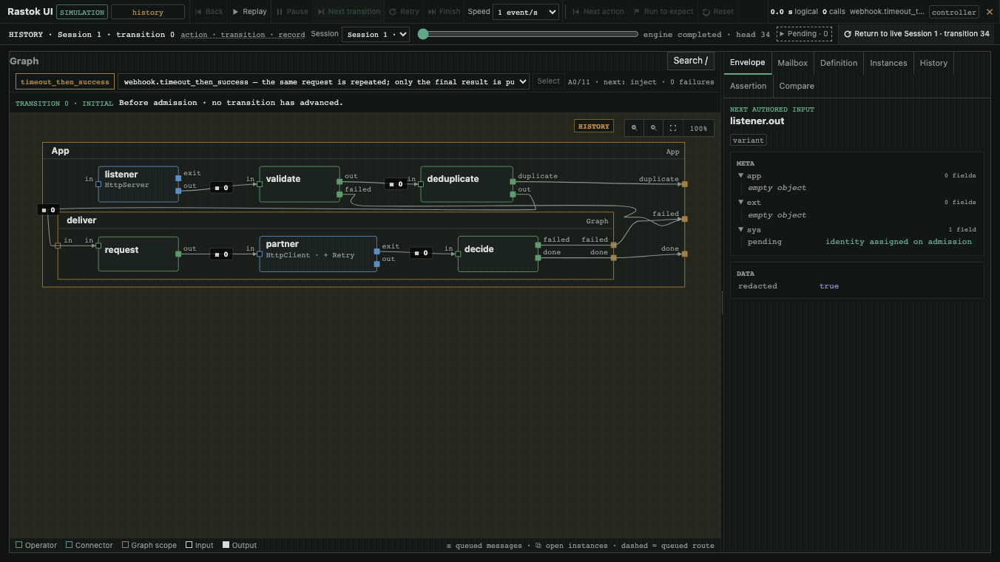

You know how to replace an effect, route its outcomes and isolate state. Now
use those ideas for a familiar integration: receive a webhook and deliver it
to a partner that is not always available. Build the flow and its failure
scenarios together, before you need a live partner environment.

## Run

From the repository root:

```sh
env RASTOK_SHOWCASE_PARTNER_TOKEN=lab-only-not-a-credential \
    RASTOK_SHOWCASE_PARTNER_TOKEN_VERSION=fixture-v1 \
    rastok simulate examples/webhook-to-partner.rkg \
      --deployment examples/webhook-to-partner.deployment.json \
      --golden crates/rastok/tests/golden/gallery/webhook-to-partner
```

Add `--ui` to inspect the same graph. No HTTP listener, real partner or paid
API is started. The value above is a **fictional fixture**, not a credential.
For real deployments, supply secret material out of band, never in source,
profile JSON or shell command text. The profile contains only its coordinate
and version. The same Contract is used with a scripted or physical Driver.

## Read the graph

Follow the main path first: `listener` admits, `validate` checks the business
data, `deduplicate` owns a `seen` flag per event, and `deliver` contains the
bounded partner retry. Open that scope to find `request`, `partner`,
`accounting` and `decide`; the complexity is composed from earlier chapters.

Then read the declarations that constrain the path: the idle lifetime, the
partner's idempotency key, the exhaustive destinations, `@personal` and the
secret reference. These are reviewable parts of the program and deployment,
not separate conventions the reader must guess from the happy path.

## Expected result

`6 scenario(s), 0 failed` covers:

- `nominal`: one `202` ACK and one partner Call ending with `201`;
- `timeout_then_success`: one second to timeout, one second of backoff,
  then success on the second application;
- `partner_dead`: two timed-out applications, then `LoopExpired`, with
  no further Call even after another ten seconds;
- `duplicate`: an explicit `seen` state suppresses a second request with
  the same event id; after five minutes idle, a fresh instance admits it again;
- `invalid_payload`: decoded JSON with the wrong shape, then a negative
  amount, both rejected after ACK and without contacting the partner;
- `http_500`: `Completed { status: 500 }` is an ordinary response; the
  graph chooses to retry it, and the second response is `201`.

The email field is `@personal`. The deployment must attest the in-memory
processing before admission; having a valid secret binding alone is not
enough. Debugger views redact before formatting. Personal data can remain in
the in-memory causal journal: presentation masking is not erasure. The bearer
is different: its clear bytes never enter the journal at all.

The typed accounting Operator interprets the fictional partner's `charge`
field as exact USD `provider_reported` evidence. The nominal reply reports
`0.02`; the `500` and successful replies report `0.01` and `0.02`, folded as
`0.03` at the accounting output for that origin. A timed-out Call supplies no charge:
an absent row is **unknown cost, not a zero bill**. This is not an invoice or
a sum across every copy of an envelope.

## Break it

Change the single `Loop.fuel = 2` to `Loop.fuel = 1`. The timeout and `500`
scenarios can no longer succeed on a second application. Rerun the command
above, without `--bless`, then restore the source.

## Read the golden difference

The CLI names the first differing record and field, expected versus actual,
and retained causal context. This classified graph deliberately redacts
values in divergence messages; it does not expose an email to explain a
failure. The opening fuel fact can differ before the final answer does.
The versioned goldens contain **only the synthetic fixture data**; they are
not sanitised exports suitable for real personal data.

The following 30-second sequence visits retained states of
`webhook.timeout_then_success`: admission, timeout, backoff and successful
second application. It is a debugger recording, not a live HTTP request or
an edited simulation branch.



Three stills make the checkpoints easier to inspect:

- [Before admission, transition 0](../assets/webhook-before.png).
- [Armed backoff, transition 18](../assets/webhook-backoff.png).
- [Success after two applications, transition 29](../assets/webhook-completed.png).

## Carry forward

This is the central exercise: one integration, several possible worlds, and
a retained explanation when a revision changes behavior. Keep the timeout,
duplicate and 500 scenarios alongside the nominal one. Each describes a case
the next change must still handle; passing them is evidence under their stated
world assumptions, not proof that every real partner will behave that way.

Previous: [Two tenants](03-two-tenants.md). Next:
[Sensor alarm](05-sensor-alarm.md). The same approach can test an event that
never arrives, without making the test wait in real time.

## Limits

Malformed JSON, failed authentication and an excessive wire body are refused
before a root or ACK exists. A decoded Lab injection cannot exercise that
decoder. The separate physical loopback proof is:

```sh
cargo test -p rastok --features hosted-http12 auth_codec_and_body_refusals_never_invent_an_inbound_call
```

An instance key isolates state; `seen` does the deduplication. This is
accept-once within an **idle** retention window: duplicates extend that
window, and a permanently failed job is still considered seen until expiry.
It is not exactly-once delivery, a durable outbox, or automatic resubmission
after failure. A restart loses that state. The partner must honour the stable
idempotency key, upsert
by `event.event_id` and treat `attempt` as audit-only; both retry paths rely
on that external property. The example does not test a real partner's
idempotence.

The supplied privacy profile describes a local synthetic demonstration, not
legal authority for production processing. Real purposes, recipients,
transfers and retention require deployment-specific review. No persistent
personal-data journal or `run --record` is admitted by this example. Kafka
and SQL are not shown. Modify the scenario on disk to try another world;
there is no debugger branch or payload editor.

## NiFi / MuleSoft equivalent

An HTTP listener, validation, a duplicate cache, an outbound call and a bounded
retry policy. The analogy is about the integration task, not feature parity:
Rastok puts the typed graph, deterministic Lab, replaceable effects and
record-level causal comparison together in versioned text.
