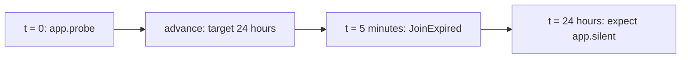

After this chapter you can read a Lab, replace a shared mock for one
scenario, assert that something did not happen, and advance virtual time
to a timeout. You can distinguish what simulation establishes from what
still needs a physical boundary test.

## Keep the program, supply its world

The real world (App) uses physical Drivers; the virtual world (Lab) supplies
scripted outcomes and time to the same graph. `lab echo` names the twin
of the App named `echo`; `simulation smoke on app` groups shared boundary
behavior and named scenarios for that App. The Lab is not deployed and
does not enter the program's semantic hash.

Here is the entire Lab from `examples/echo.rkg`, lines 24–54:

```rkg
lab echo {
  simulation smoke on app {
    mock shell {
      on in {
        out = .
        exit = Exited { exit_code = 0, signal = null }
      }
    }

    scenario roundtrip "a line echoes back" {
      app.in = "salut"
      expect "the echo" app.out count == 1 where data == "salut"
      expect nothing shell.err
    }

    scenario filtered "an empty line never reaches the shell" {
      app.in = ""
      expect nothing shell.in
      expect nothing app.out
    }

    scenario silence_expires "a mute shell times out" {
      mock shell {
        on in { out = nothing }
      }
      app.in = "salut"
      advance duration("5s")
      expect "the typed timeout" shell.exit where data is TimeoutExpired
    }
  }
}
```

The mock supplies the Process response, not the Operator's decision. The
real `relay` handler still filters the input. In `roundtrip`, the script
returns the request data and one successful terminal. That response passes
through the normal Contract and journal machinery, which creates its records.

## Silence must be explicit

The `silence_expires` scenario replaces the whole shared mock for `shell`.
Its `out = nothing` is deliberate silence, not an omitted response that
the simulator guesses. The Call remains open until the explicit time
advance reaches its five-second deadline. The runtime then produces the
typed `TimeoutExpired` terminal. No child process was started.

For an outbound Call, an uncovered request fails the scenario rather than
silently timing out. A missing mock and an authored silent mock are
different tests. A scenario-level mock replaces, rather than extends, the
simulation-level mock for that Connector. Within a mock, the first
matching clause in source order supplies the response.

## Read expectations in their action window

An input injection or an `advance` starts an observation window. Subsequent
expectations read that window without consuming it. They do not scan all
earlier actions in the scenario. Ready work settles before those assertions
are evaluated, so an expectation does not race a half-finished transition.

`expect app.out count == 1 where ...` checks an exact matching count.
`expect nothing shell.in` asserts absence. The empty-input scenario therefore
proves more than an empty App output: it proves that the Process was never
called. Assertions observe ports, not an Operator's private state directly.

An emission can be observed at its source even when the graph routes it to
`nothing`. That is why the timeout can be asserted on `shell.exit` although
Echo discards that output. `app.out`, in contrast, observes an actual crossing
of the App boundary, not every child output.

## Advance to a deadline, not through a sleep

The sensor example has a five-minute join window between a probe and a
heartbeat. Its `virtual_day` scenario, from `examples/sensor-alarm.rkg`,
lines 72–77, supplies no heartbeat:

```rkg
scenario virtual_day "twenty-four hours without waiting twenty-four hours" {
  app.probe = { sensor = "pump-a" }
  advance duration("24h")
  expect app.silent count == 1 where data is JoinExpired
  expect nothing app.alarm
}
```

The advance visits the five-minute expiry before reaching its twenty-four-hour target.



Ready computations take no virtual time. The simulator processes due
obligations in time order, including work they cause, then reaches the
requested target. This tests a day-long timeline without sleeping for a
day.

## Inspect source

`--ui` opens the source debugger. **Next transition** marks the recorded node,
port or selected arm. Hover or focus an identifier for a read-only summary;
Escape closes it. The tooltip links to the inspector and preserves redaction.
**Graph** is secondary; selecting a node prepares its source definition and
inspector context.

## Know the evidence boundary

Run `rastok simulate examples/echo.rkg` to check its three scenarios.
Add `--compare crates/rastok/tests/golden/gallery/echo` to compare their
causal traces as well. Expectations express selected requirements; the
golden comparison can reveal other changed facts. `--save` writes new
references and is a separate, reviewed action.

A scripted outcome proves how the checked graph responds to that outcome.
It does not prove a real partner obeys the Contract. In particular, a
decoded HttpServer Lab injection cannot test malformed wire JSON or
authentication before admission. Automatic incident-to-scenario conversion
and authored crash/restart actions are not executable Lab features today;
see [the current limits](../index.md#what-is-available-today).

The normative sources are `docs/spec/simulation-semantics.md` and
`docs/spec/execution-model.md`, section 8. `WHITEPAPER.md`, sections 5 and 6,
explains the distinction between time, simulation and future proof tooling.

## Summary

- A mock substitutes the external response, not the graph's computation.
- Silence and absence are authored, observable test cases.
- Expectations read the latest action window.
- Virtual time resolves real graph obligations without waiting in real time.

## Next

Read [Running for real](05-running-for-real.md). Experiment with
[Echo](../examples/01-echo.md) and
[Sensor alarm](../examples/05-sensor-alarm.md) to compare ordinary replies,
silence and time-dependent outcomes.
