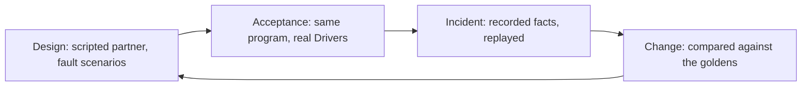
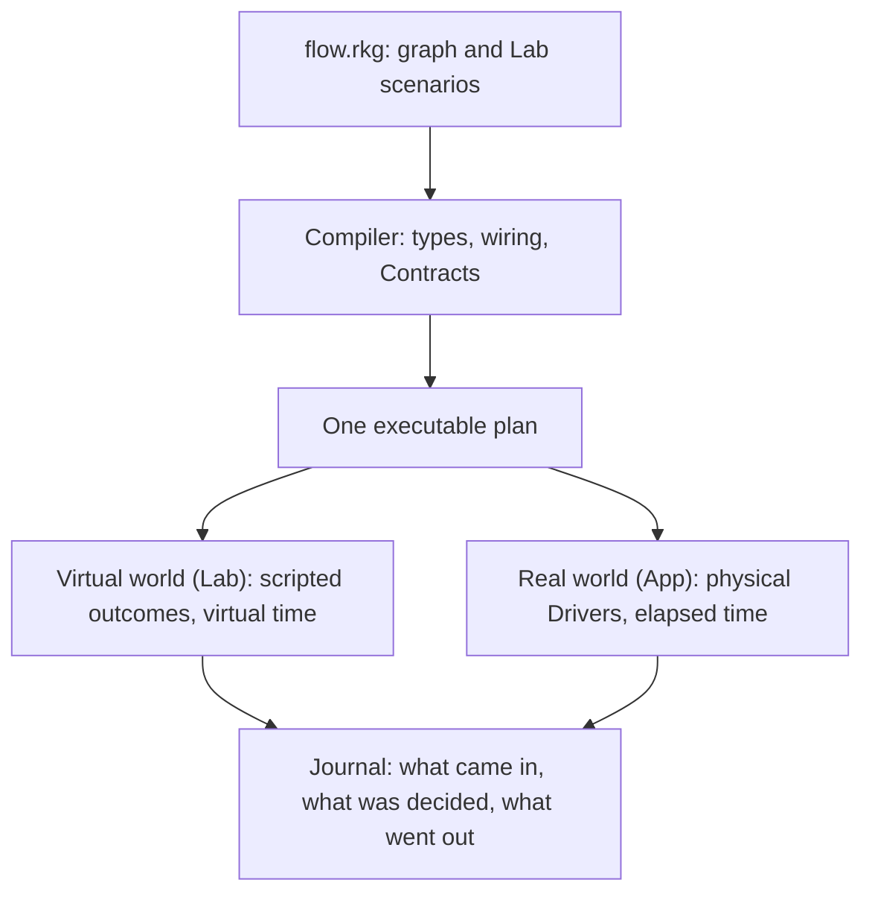
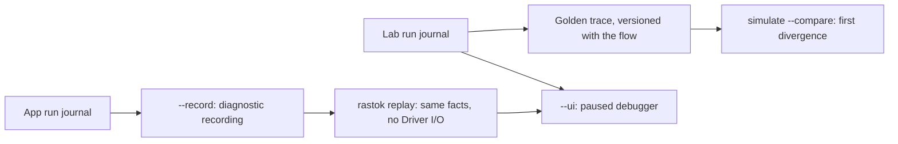

## What is Rastok?

An integration rarely arrives whole. The partner's test environment is not
ready, or never fails the way production will. The person who knew why a
retry stops after two attempts has left with the project. A case nobody
thought of shows up in production, and the logs say what happened, not why.
Flows break for human reasons before technical ones, and those reasons do
not go away.

Rastok puts that knowledge in a file that outlives the people and the
project: the flow, the scenarios that test it, faults included, and a
journal that explains each run. Within the supported Contract and Lab
profiles, the same checked program runs against scripted partners in the
Lab or against real systems in the App, without rewriting the graph.

This page is the map. [Getting started](getting-started.md) installs the
tool and opens the two paths: the user guide, or the
[examples](examples/01-echo.md).

## What it is for

Four moments in the life of an integration, and what the file changes at each.



| Moment | What teams usually have | What the file gives |
|---|---|---|
| Design | A partner that is not ready, a contract nobody has exercised | A scripted partner in the Lab, with fault scenarios from the first day |
| Acceptance | A second version of the flow for the real environment | The same checked program, with real Drivers |
| Incident | Logs that say what happened, not why | Recorded facts, replayed without side effects, then a scenario that reproduces them |
| Change | The fear of breaking what works | `--compare` against the reviewed goldens, with the first divergence named |

The alpha does not automatically convert a recording into a Lab scenario:
writing the scenario is a human step. Keep it, with its reviewed golden, so
the next change can be checked against it.

## How it works

### The smallest program

`examples/echo.rkg` is a whole integration in one file. A nonempty line of
text enters; under `rastok run`, a real `cat` process echoes it and the echo
leaves.

```rkg
graph echo : App {
  connector shell : Process {
    mode = job ; command = "cat"
    codec = lines
    idempotent = true; behavior = deterministic
    timeout = duration("5s")
  }

  operator relay {
    on in where data != "" {
      out = data
    }
  }

  in -> relay -> shell -> out
  shell.err -> nothing
  shell.exit -> nothing
}
```

Three kinds of Node appear here, and one Extension.

- `graph echo : App` is the **Graph**: a typed boundary, its children and
  their static wiring. A Graph owns scope and lifetime; it has no
  application handler. `App` is the **Extension** that marks the public root.
- `operator relay` is an **Operator**: the decision. A typed transition
  that may keep private state and never performs external I/O.
- `connector shell : Process` is a **Connector**: an explicit boundary to
  the outside, under one exact, versioned **Contract**. A **Driver**
  implements the Contract: a real process in the App, a script in the Lab.
- `shell.err -> nothing` and `shell.exit -> nothing` are decisions the
  compiler can see. Every output the compiler considers possible needs an
  explicit destination, including `nothing` for a deliberate discard.
  An output proven impossible needs no destination.

Two other Extensions exist in the alpha. `Loop` adds finite recurrence
over time. `Retry` repeats the same outbound Call under a bounded policy
the compiler checks. The executable standard Contract families are
`Process`, `File`, `HttpClient`, `HttpServer`, `WebSocketClient` and
`WebSocketServer`; `rastok connectors` lists their modes, installed
implementations and Lab limits.

The Lab lives in the same file. This is the scenario that tests the fault
case, a process that never answers:

```rkg
scenario silence_expires "a mute shell times out" {
  mock shell {
    on in { out = nothing }
  }
  app.in = "salut"
  advance duration("5s")
  expect "the typed timeout" shell.exit where data is TimeoutExpired
}
```

Time is an input: `advance` moves the virtual clock by five seconds and the
timeout becomes a typed fact the scenario asserts. No process starts.
Adding a scenario changes nothing in the program's identity: the Lab is
part of the source, not of the semantic hash. The [first example](examples/01-echo.md)
runs this file, breaks it and reads the result.

### One source, one plan, two worlds

The real world (App) and the virtual world (Lab) use different Drivers
around the same compiled graph and journal semantics.



Each command compiles the source; `rastok check` validates it, rather than
writing a plan file that the other commands require. The compiler rejects an
ill-typed or badly wired graph before it runs. What it accepts becomes a
plan: tables and expression trees, not generated code. The runtime
interprets that plan. `rastok simulate` supplies scripted boundary responses
and virtual time; `rastok run` uses physical Drivers and explicit elapsed
time.

The core reads no clock, network or randomness: CI builds it for targets
without an operating system and runs the RP2350 spike under Cortex-M33
emulation; [Sensor alarm](examples/05-sensor-alarm.md#carry-forward) states
the tested boundary and the physical-board limit.

### The rule that makes two worlds possible

Operators decide. Connectors act. Outcomes return as typed observations
that execution records in the journal. This is the conceptual separation,
not the signature of a public API:

```text
step(plan, state, event) -> (new_state, effect_intents)

Driver execution : effect_intents -> real outcomes
Lab simulation   : effect_intents -> controlled outcomes
```

The runtime commits an outbound obligation before asking its Driver to
perform the effect. A scripted partner can therefore stand in for one that
is not ready. Supported faults and timeouts become scenarios, while the
same checked program can later use real Drivers.

### What a run leaves behind

Execution writes an in-memory journal: typed records in causal order for
what came in, what was decided and what went out. Three things use it.



- **Golden traces.** A scenario's journal is projected into a canonical
  trace. Save it, review it and version it with the flow. `rastok simulate
  flow.rkg --compare <directory>` reports the first divergence for each
  differing scenario. For the same program, equal ingress provenance,
  ordered inputs and boundary outcomes, and observable logical time give
  equal causal facts. Real runs and Lab runs use different ingress
  provenance by default; matching displayed output alone does not give
  matching trace seals.
- **The debugger.** `rastok simulate flow.rkg --ui` starts paused. Forward
  controls advance the simulation and record transitions; history navigation
  inspects those recorded transitions. It does not edit the flow or fork
  another world. `run --ui` is not supported.
- **Recordings.** `rastok run flow.rkg --record capture.rkrec` captures a real
  run. `rastok replay capture.rkrec`, optionally with `--ui`, reconstructs
  the recorded state without any Driver I/O. Recordings are bounded,
  sensitive local files, not a durable deployment journal. The current
  recorder refuses personal-data plans, nonempty deployment attestations
  and boot-dependent Connector settings.

## What Rastok is not

- Not a durable workflow engine yet. The journal is in memory; durable
  storage is later work.
- Not an exhaustive catalogue of ready-made connectors. Six standard
  Contract families are executable today. `rastok connectors` lists modes,
  support and installed implementations; declared but non-executable families
  are marked as deferred.
- Not a visual designer. The source is text, versioned in Git. The debugger
  explains recorded execution; it does not edit the flow.
- Not a proof about the outside world. Passing a simulation does not prove
  that an external system honors its Contract, or make the alpha
  production-ready.

## What is available today

Checked on 30 October 2026 for the planned 5 November `v0.1.0-alpha`
opening. Rastok is experimental. The
deployment journal is in memory; durable storage is later work. Diagnostic
replay restores recorded facts, not the world. Eight runnable examples cover
echo through agents, including the resident gateway and typed HTTP model adapter.
The full opening qualification remains in progress. No reading-time claim is made before independent
installation trials.

## Vocabulary

| Term | Meaning |
|---|---|
| Graph | Typed boundary, children and wiring; owns scope and lifetime |
| Operator | Typed transition with private state; no external I/O |
| Connector | Explicit boundary to an external system, under one Contract |
| Contract | Exact, versioned interface of a Connector |
| Driver | Implementation of a Contract: physical in the App, scripted in the Lab |
| Extension | Protocol attached to one Node; executable here: `App`, `Loop`, `Retry` |
| Lab | Scenarios that script boundary outcomes, time and faults |
| Plan | The compiled, executable form of a program |
| Semantic hash | Identity of the program, independent of formatting and of the Lab |
| Journal | Typed causal records and unsealed recovery evidence of a run |
| Golden trace | Versioned canonical projection of a scenario's journal |
| Recording | Captured real run, replayable without Driver I/O |

## Where to go next

Use [Reference](reference/types.md) to look up types, expressions, Contracts,
Lab syntax and diagnostics.

- Install and run a first graph: [getting started](getting-started.md).
- The short route through the examples: [echo](examples/01-echo.md), then
  [webhook to partner](examples/04-webhook-to-partner.md).
- The normative specification and architecture notes live in the repository,
  under `docs/spec` and `docs/architecture`.
