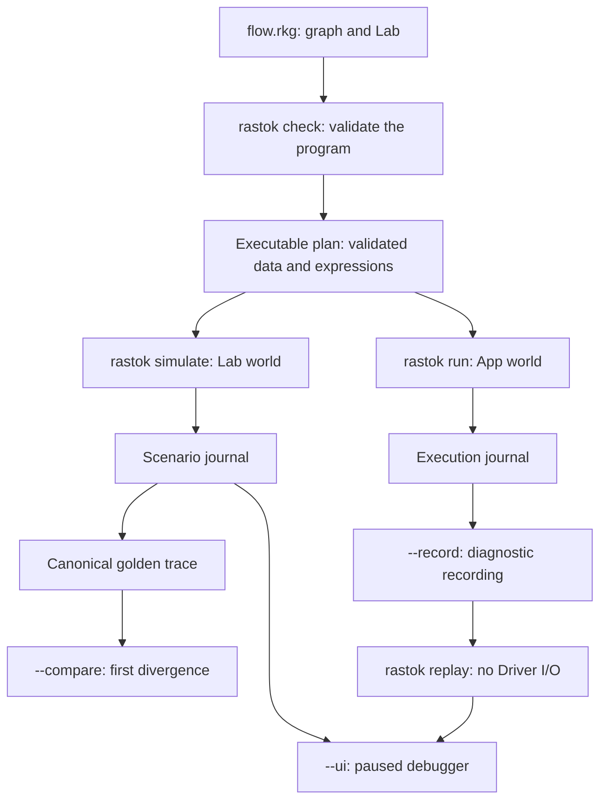

This page is the map. The [quickstart](quickstart.md) and the
[gallery](index.md#learning-path) are the path.

Rastok is a simulation-first integration platform: a typed flow language, a
compiler, a runtime and a Lab. You write an integration and its scenarios
together, versioned with the source. Within the supported Contract and Lab
profiles, the same checked program runs against scripted outcomes or real
systems without rewriting the graph.

## One source, one plan, two worlds

The App and Lab share compilation and journal semantics, but use different Drivers.



Each command compiles the source; `check` validates it, rather than writing
a plan file that the other commands require. The compiler rejects an
ill-typed or badly wired graph before it runs. What it accepts becomes a
plan: tables and expression trees, not generated code. The runtime
interprets that plan. The Lab supplies scripted boundary responses and
virtual time; the App uses physical Drivers and explicit elapsed time.

## What a program contains

- **Graph.** A typed boundary, children and static wiring. A Graph owns scope
  and lifetime; it has no application handler.
- **Operators.** The decisions. Typed transitions that may keep private state
  and never perform external I/O.
- **Connectors.** The explicit external boundaries. Each follows one exact,
  versioned Contract. The executable standard families are `Process`, `File`,
  `HttpClient`, `HttpServer`, `WebSocketClient` and `WebSocketServer`.
  `rastok connectors` lists their modes, installed implementations and Lab
  limits. A Driver implements a Contract: physical in the App, scripted in
  the Lab.
- **Extensions.** Attached to one Node. `App` marks the public root. `Loop`
  adds finite temporal recurrence. `Retry` repeats the same outbound Call
  under a bounded policy the compiler checks.
- **Lab.** Scenarios written next to the graph. They supply inputs, boundary
  responses, time advances and assertions. The Lab is part of the source,
  not the program's identity: adding a scenario leaves the semantic hash
  unchanged.

## The rule that makes two worlds possible

Operators decide. Connectors act. Outcomes return as typed observations
that execution records in the journal. This is the conceptual separation,
not the signature of a public API:

```text
step(plan, state, event) -> (new_state, effect_intents)

Driver execution : effect_intents -> real outcomes
Lab simulation   : effect_intents -> controlled outcomes
```

The runtime commits an outbound obligation before asking its Driver to
perform the effect. A scripted partner can therefore stand in for one that
is not ready. Supported failures and timeouts become scenarios, while the
same checked program can later use real Drivers. Passing a simulation does
not prove that an external system honors its Contract or make the alpha
production-ready.

## What a run leaves behind

Execution writes an in-memory journal: typed records in causal order for
what came in, what was decided and what went out. Three things use it.

- **Golden traces.** A scenario's journal is projected into a canonical
  trace. Save it, review it and version it with the flow. `rastok simulate
  flow.rkg --compare <directory>` reports the first divergence for each
  differing scenario. For the same program, equal ingress provenance,
  ordered inputs and boundary outcomes, and observable logical time give
  equal causal facts. Real runs and Lab runs use different ingress
  provenance by default; matching displayed output alone does not give
  matching trace seals.
- **The debugger.** `rastok simulate flow.rkg --ui` starts paused. Forward
  controls advance the simulation and record transitions; history navigation
  inspects those recorded transitions. It does not edit the flow or fork
  another world. `run --ui` is not supported.
- **Recordings.** `rastok run flow.rkg --record capture.rkrec` captures a real
  run. `rastok replay capture.rkrec`, optionally with `--ui`, reconstructs
  the recorded state without any Driver I/O. Recordings are bounded,
  sensitive local files, not a durable deployment journal. The current
  recorder refuses personal-data plans, nonempty deployment attestations
  and boot-dependent Connector settings.

## The life of an integration

Design and test it in the Lab, with failure scenarios from the beginning.
Meet the real systems in acceptance with the same program. When an incident
happens, inspect its recorded facts and write a scenario that reproduces the
relevant inputs and outcomes. The alpha does not automatically convert a
recording into a Lab scenario. Keep the scenario and its reviewed golden so
the next change can be checked against it.

## Vocabulary

| Term | Meaning |
|---|---|
| Graph | Typed boundary, children and wiring; owns scope and lifetime |
| Operator | Typed transition with private state; no external I/O |
| Connector | Explicit boundary to an external system, under one Contract |
| Contract | Exact, versioned interface of a Connector |
| Driver | Implementation of a Contract: physical in the App, scripted in the Lab |
| Lab | Scenarios that script boundary outcomes, time and faults |
| Plan | The compiled, executable form of a program |
| Semantic hash | Identity of the program, independent of formatting and of the Lab |
| Journal | Typed causal records and unsealed recovery evidence of a run |
| Golden trace | Versioned canonical projection of a scenario's journal |
| Recording | Captured real run, replayable without Driver I/O |

## Where to go next

- Install and run a first graph: [quickstart](quickstart.md).
- The short route through the gallery: [echo](gallery/01-echo.md), then
  [webhook to partner](gallery/04-webhook-to-partner.md).
- What exists today and what does not yet:
  [what is available today](index.md#what-is-available-today).
- The normative specification and architecture notes live in the repository,
  under `docs/spec` and `docs/architecture`.
